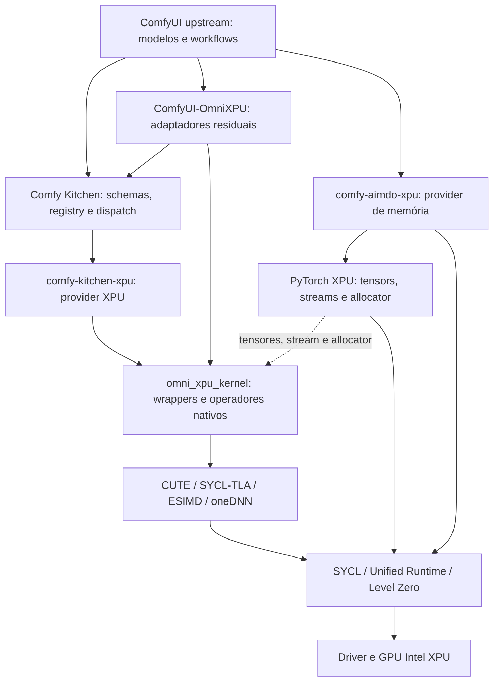
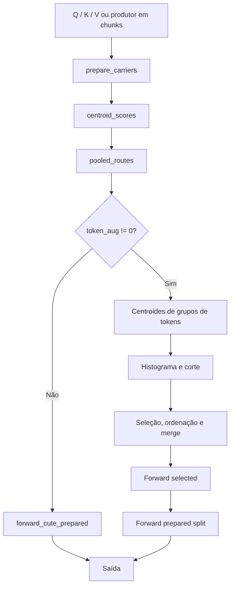
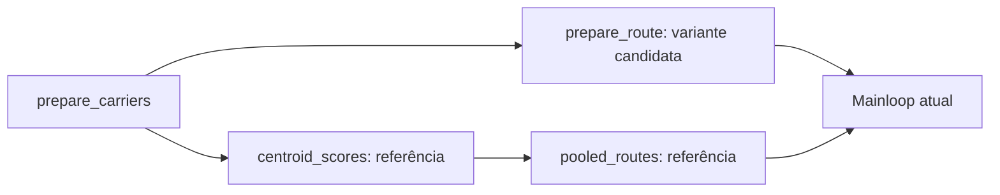
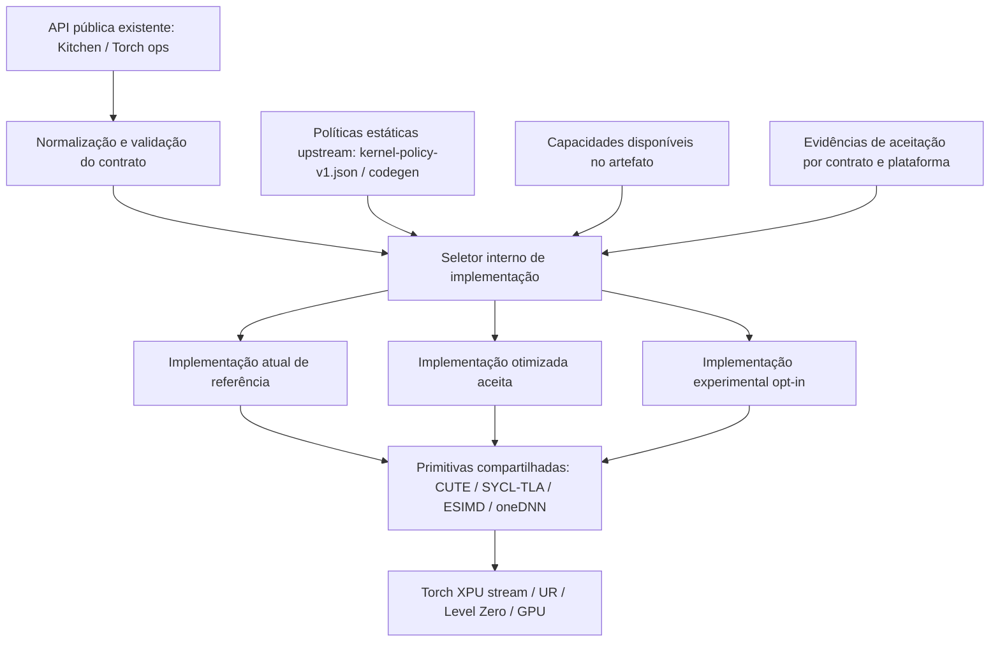
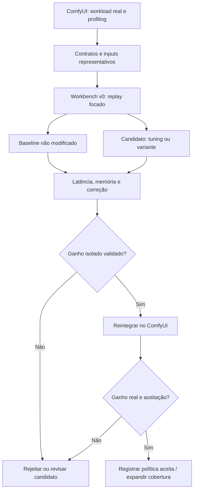
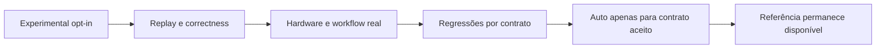

# Arquitetura e plano de evolução retrocompatível do OmniXPU

**Escopo:** Intel LLM Scaler Omni, `omni_xpu_kernel`, integração ComfyUI e GPUs Intel XPU.  
**Referência temporal:** 25 de novembro de 2026.  
**Repositório de desenvolvimento:** [`wildersa/llm-scaler`](https://github.com/wildersa/llm-scaler).  
**Caso inicial de investigação:** MiniMax H3, Arc Pro B70, Windows, geração de vídeo de 243 frames.

## 1. Conclusão executiva

A arquitetura atual do Intel LLM Scaler Omni já separa adequadamente os kernels nativos, o despacho genérico de operadores, o gerenciamento de memória dinâmica e a integração com o ComfyUI. A estratégia de evolução deve preservar essas fronteiras, aproveitar as políticas de hardware e os mecanismos de especialização existentes e introduzir novas implementações apenas quando houver evidência de ganho ou necessidade de correção.

O objetivo é melhorar desempenho, estabilidade e eficiência de memória do `omni_xpu_kernel`, mantendo a compatibilidade com os modelos, versões e plataformas atualmente funcionais. O MiniMax H3 é um workload inicial exigente, não o limite arquitetural da solução. As melhorias devem beneficiar quaisquer consumidores que satisfaçam os mesmos contratos de execução.

A distribuição em uso foi identificada como uma wheel `0.2.0b3`, Torch 2.13/XPU, alvo BMG, baseada na revisão `1101fd71e10757e90bb6aae0eddbe1aea6317bb3` do LLM Scaler. A árvore upstream de referência declara `0.2.0b4` e apresenta evolução relevante no backend CUTE, na atenção esparsa e nas políticas de GPU. A primeira intervenção deve ser estabelecer um baseline reproduzível entre essas duas revisões, e não alterar o kernel. O `main` é móvel: deve-se registrar e fixar o SHA efetivamente selecionado.

O resultado observado de aproximadamente **101,8 s por iteração de denoising em 243 frames** é a motivação para a investigação. Ele não comprova que o Sol-Attn seja o gargalo principal. Atenção densa, preparação e roteamento esparsos, GEMMs quantizados, conversões de layout, alocação, residência, sincronizações e lacunas na fila GPU são candidatos que precisam ser medidos separadamente.

A estratégia técnica é:

1. Auditar o fork, o upstream e os testes disponíveis; preservar o ambiente funcional.
2. Recompilar e validar a revisão b4 no mesmo ambiente, isolando a variável kernel.
3. Perfilar o workflow real e identificar os operadores, contratos e gargalos predominantes.
4. Criar uma bancada mínima de replay e comparação A/B, reutilizando a infraestrutura upstream.
5. Explorar parâmetros de tuning existentes antes de modificar C++/SYCL.
6. Introduzir variantes internas de kernel somente quando a evidência justificar, preservando as implementações de referência.
7. Validar o ganho end-to-end, a correção numérica, a estabilidade e a retrocompatibilidade antes de promover qualquer variante.

Não há justificativa inicial para criar um executor exclusivo do H3, substituir o Comfy Kitchen, abandonar o PyTorch, reescrever o Sol-Attn integralmente ou migrar a ABI. Essas iniciativas aumentariam a superfície de manutenção sem um benefício ainda demonstrado.

## 2. Objetivos, requisitos e limites

### 2.1 Objetivos

- Reduzir o tempo de geração e o custo por iteração, priorizando os componentes com maior impacto real.
- Reduzir materializações, transferências e alocações desnecessárias quando identificadas.
- Melhorar a utilização dos XMX/DPAS, a ocupação e a eficiência de memória conforme o perfil de cada operação.
- Manter os caminhos existentes disponíveis e permitir rollback por configuração ou por artefato.
- Preservar os contratos numéricos e semânticos dos operadores, inclusive os controles de atenção esparsa.
- Manter a evolução próxima do upstream, com patches pequenos, testáveis e potencialmente contribuíveis.
- Construir uma capacidade incremental de comparação de kernels e de detecção de regressões entre futuras versões.

### 2.2 Escopo e critérios de evidência

| Classificação | Significado | Uso na implementação |
|---|---|---|
| Fato arquitetural | Comportamento ou interface identificada na revisão de referência do código/documentação | Confirmar na revisão efetivamente compilada |
| Relato externo | Medição, falha ou correção observada em outro ambiente | Reproduzir localmente antes de portar correções |
| Hipótese de desempenho | Explicação plausível ou estimativa analítica | Validar com profiling e experimentos controlados |
| Decisão arquitetural | Diretriz de implementação e governança | Aplicar respeitando os gates de aceitação |
| Resultado experimental | Medição reproduzível no ambiente alvo | Usar para promover, rejeitar ou revisar uma mudança |

O baseline de 101,8 s/it ainda não possui decomposição de tempo por operador neste plano. Não existe meta percentual de ganho definida a priori. A compatibilidade é um requisito de engenharia verificável para os contratos cobertos pelos testes, não uma garantia absoluta para toda combinação possível de hardware, driver e software.

## 3. Arquitetura atual do ecossistema OmniXPU

### 3.1 Fronteiras de responsabilidade

O diagrama representa responsabilidades e dependências lógicas, não uma sequência obrigatória de chamadas. O kernel consome tensores, allocator e stream do PyTorch XPU; os caminhos nativos despacham trabalho sobre o runtime SYCL/UR/Level Zero, sem retornar ao PyTorch como etapa obrigatória de execução. O AIMDO atua em paralelo à execução dos kernels; não é uma etapa computacional de atenção ou GEMM.

| Componente | Responsabilidade | Limite da intervenção |
|---|---|---|
| ComfyUI upstream | Arquitetura dos modelos, workflow, preparação de entradas, política de atenção e integração de memória | Preservar checkout limpo; corrigir aqui apenas problemas pertencentes à aplicação |
| ComfyUI-OmniXPU | Adaptar pontos residuais não cobertos pelo Kitchen e aplicar compatibilidade opt-in | Evitar duplicar operadores genéricos ou criar patches preventivos |
| Comfy Kitchen | APIs, schemas, registry, constraints e política de escolha de backend | Preservar o contrato público |
| `comfy-kitchen-xpu` | Provider que anuncia capacidades realmente disponíveis, valida a companion wheel e encaminha operações ao kernel | Alterar apenas quando a adaptação ou integração exigir |
| `comfy-aimdo-xpu` | DynamicVRAM, residência, virtualização e interação com o allocator/runtime XPU | Tratar separadamente de otimizações de kernels |
| `omni_xpu_kernel` | Operadores nativos, especializações de hardware, layouts, dispatch interno e implementações SYCL/C++ | Escopo principal do desenvolvimento |
| SYCL-TLA / ESIMD / oneDNN | Primitivas matriciais, vetoriais e GEMMs | Reutilizar abstrações e manter revisões pinadas |
| PyTorch XPU / UR / Level Zero | Tensors, filas, sincronização, alocação e execução no dispositivo | Respeitar ownership, streams, ABI e semântica assíncrona |

Os kernels nativos permanecem no [`intel/llm-scaler`](https://github.com/intel/llm-scaler), enquanto o [`xiangyuT/comfy-kitchen-xpu`](https://github.com/xiangyuT/comfy-kitchen-xpu) constitui o provider consumidor. Sua documentação de [companion wheels](https://github.com/xiangyuT/comfy-kitchen-xpu/blob/main/packaging/omni_xpu_kernel/README.md) estabelece revisão do kernel, revisão do SYCL-TLA, target AOT, requisitos de runtime e validação do artefato. O fork de desenvolvimento deve preservar esse modelo de distribuição.

### 3.2 Integração e observabilidade

A extensão ComfyUI-OmniXPU organiza adaptadores e patches em um registro de componentes (`COMPONENTS`), com flags individuais, classificação e estado de aplicação. O mecanismo de bootstrap dos providers, incluindo `OMNIXPU_PROVIDER_BOOTSTRAP`, possibilita verificar compatibilidade antes da ativação. O nó OmniXPU Status e os diagnósticos de despacho do Kitchen são superfícies existentes de observabilidade que devem ser auditadas antes de criar instrumentação adicional.

Atenção esparsa deve seguir o caminho nativo do `BlockSparseAttention` quando disponível. O adaptador estende elegibilidade e compatibilidade, enquanto controles dependentes de modelo, seleção de blocos, preparação de QKV e chunking do produtor pertencem às camadas que possuem o contexto do modelo. Não introduzir ramificações como `if model == MiniMaxH3` dentro de um operador genérico.

O AIMDO pode utilizar mecanismos de reserva de endereços virtuais Level Zero e integração com o allocator XPU. A forma efetiva de residência e streaming varia por sistema operacional e versão. Alterações de alocação no kernel devem respeitar a política já instalada, evitando duplicar um mecanismo de gerenciamento de VRAM.

### 3.3 Superfície de operadores

O pacote reúne operadores de atenção, quantização, álgebra linear, normalização e transformação de layouts. O catálogo abaixo descreve as famílias documentadas e os contratos de interesse; não é uma lista de símbolos garantidos em todas as wheels. A referência é o [README do kernel](https://github.com/intel/llm-scaler/blob/main/omni/omni_xpu_kernel/README.md), complementado pela [integração OmniXPU](https://github.com/intel/llm-scaler/blob/main/omni/ComfyUI-OmniXPU/README.md).

| Família | Motor predominante | Operadores e contratos relevantes | Pontos de investigação |
|---|---|---|---|
| `sdp` | ESIMD/SYCL | `sdp.sdp`, caminho `lgrf_sdp` | Precisão de acumuladores, elegibilidade e overflow em ativações de grande magnitude; não ampliar despacho automático sem teste |
| `cute` | CUTLASS-SYCL / SYCL-TLA | `cute.sdp`, `sdp_bhld_d128`, `sdp_bhld_d120`, `sdp_bhld_fp32_d72` | D128 FP16/BF16, layouts BHLD packed, BLHD-backed e H3 QKV-backed; D72 usa produtos TF32 high/low para entrada FP32, não é redução FP32 bit a bit |
| `cute` — especializações | CUTE | `sdp_minimax_h3_vae_d64`, `sdp_wan22_cross` | VideoVAE H3 FP16 `[1,32,S,64]` com strides próprios; Wan 2.2 14B Turbo tem contrato exato FP16 BMG Q `[1,75600,40,128]`, K/V `[1,512,40,128]`; outros casos permanecem nos caminhos elegíveis |
| `cute.sol_attn` / `sol_attn_v2` | CUTE + SYCL | `prepare_with_controls`, `forward_cute_with_controls`, `prepare_carriers`, `centroid_scores`, `pooled_routes` e caminho `token_aug` | Contrato público BMG BF16 BTHD D128, dimensão final contígua, self-attention sem máscara, causal, GQA ou cross-attention; manter política e controles |
| `int8` | ESIMD + oneDNN | `quantize_int8_tensorwise`, `quantize_int8_rowwise`, `int8_linear`, `int8_linear_prequantized`, `w4a8_linear_prequantized`, ConvRot, GELU/SwiGLU | Quantização, reescalonamento, bias, formato de peso, custo de reorder; W4A8 documentado para decode de 1–8 linhas, com reconstrução dos pesos no dot product e sem matriz INT8 completa |
| `linear` / `fp8` | oneDNN + ESIMD | `onednn_w8a16_fp8`, `quantize_per_tensor`, `dequantize_per_tensor`, `stochastic_rounding` | FP8 weight-only não implica computação FP8 em todos os caminhos; preservar política de arredondamento e ABI oneDNN |
| `norm` / layout | ESIMD/SYCL | RMSNorm, LayerNorm, GroupNorm, modulação segmentada e AdaLN | Auditar símbolos como `rms_norm_segmented_modulation`, `group_norm_bmg`, `group_norm_seedvr_bmg` e fusões quando disponíveis; preservar dtype, strides e tolerâncias |
| `rotary` | SYCL/ESIMD | RoPE, RMS-RoPE, `apply_kitchen_rope` e especializações D128 | Verificar variantes de RoPE, dimensões parciais e layouts; não confundir convenções NeoX e interleaved |
| `gguf` / `svdq` | ESIMD + oneDNN | GGUF Q4_0/Q4_1/Q8_0/Q4_K/Q6_K, `dequantize_batch`, SVDQuant W4A4 e pós-processamento | Validar formatos packed, scales, alinhamento e materialização; cobertura de W4A8 deve ser verificada separadamente |
| `kitchen` | SYCL + oneDNN | `gemv_awq_w4a16`, `group_norm_silu_pad3d`, `group_norm_silu_pad3d_out`, `fp16_conv3d`, `fp16_conv3d_out` | AWQ W4A16 documentado: GEMV até 8 linhas, desquantização + oneDNN GEMM acima; variantes `_out` permitem escrita em views compatíveis. Inventariar outras rotas de decode/DeltaNet antes de declará-las suportadas |

**Inventário operacional:** consultar `native_capabilities()`, as funções `supports_*`, `device.info(index)` e metadata da wheel; em Linux, verificar `core_aot_target() == __xpu_target__`. O manifesto de build e a lista de símbolos devem ser registrados juntos. Capacidade anunciada não equivale a elegibilidade de qualquer shape nem a superioridade de desempenho. Identificar os operadores efetivamente chamados pelo provider e seus fallbacks, não apenas os que existem no código.

Em particular, medir separadamente a quantização, ConvRot e as projeções. O adaptador upstream documenta uma rota opt-in para compartilhar ConvRot e quantização rowwise INT8 entre Q/K/V do Qwen-Image 2.1 (`OMNIXPU_QWEN_IMAGE21_QKV`), dependente de BF16 contíguo e projeções compatíveis. É um exemplo de otimização produtor-consumidor já existente a ser inventariada, não uma regra geral para outros modelos.

### 3.4 Empacotamento, ABI e versões

Na revisão de referência `0.2.0b4`, o kernel reconhece Torch XPU 2.10–2.14, sendo o Torch 2.13 a referência de build completo documentado. Reconhecimento de uma versão não equivale a validação funcional em todas as combinações. A distribuição deve manter artefatos específicos por versão compatível do Torch e target AOT, incluindo requisitos de Python, compilador e runtime nativo.

O build CUTE no Windows possui caráter experimental e requer validação própria. Não presumir que uma wheel Linux BMG seja equivalente a uma wheel Windows BMG, nem que targets BMG, DG2 e PTL-H sejam intercambiáveis. Cobertura oficial e cobertura de forks comunitários devem ser distinguidas.

O pacote contém uma integração híbrida: bindings legados baseados em `pybind11` e operadores modernos registrados via `TORCH_LIBRARY`/`torch.ops`. A existência de uma interface legada não exige substituir toda a camada de bindings. A migração de um operador para o dispatcher deve ser orientada por problemas reproduzidos de integração, graph breaks ou necessidade de `torch.compile`.

Para Torch 2.13, o README do kernel documenta oneDNN 3.11.2 (pacotes Linux 2026.0.0 e instalação oneAPI 2026.0 correspondente no Windows), incluindo empacotamento da `dnnl.dll` no Windows. A identidade de wheel segue o padrão PEP 440 `<versão>+torch<minor>.<target>`; registrar também SO, Python, hash, revisão do compilador e dependências. A nomenclatura de target deve vir do build, não ser inferida da grafia do SKU.

Construir com os headers do ambiente alvo (`--no-build-isolation --no-deps` conforme documentação) e instalar a wheel experimental em ambiente separado. `--force-reinstall --no-deps` pode ser utilizado somente após verificar que todas as dependências já são compatíveis; não usar para mascarar incompatibilidade. Validar importação fora da árvore de fontes, evitando que o checkout esconda o pacote instalado. Em Windows, o README distingue o build experimental do sidecar CUTE (headers SYCL-TLA e `OMNI_XPU_REQUIRE_CUTE=1`) da seleção de runtime (`OMNI_ATTN_BACKEND=cute`); conferir os dois, de acordo com a revisão e o provider efetivo.

A matriz inicial deve manter Torch 2.13 e o ambiente atualmente funcional. APIs de Torch 2.15, como opções adicionais de `MemPool` e recursos de profiling/captura XPU, são melhorias futuras condicionadas à disponibilidade e validação da ABI; não são premissas da arquitetura.

## 4. Microarquitetura Intel XPU e restrições de execução

### 4.1 BMG-G31, BMG-G21, DG2 e PTL-H

A Arc Pro B70 é o alvo inicial de experimentação. A ficha técnica Intel informa 32 Xe2 cores, 256 XMX, 32 GB GDDR6, interface de 256 bits, largura de banda nominal de 608 GB/s e 367 TOPS INT8 de pico. O desempenho efetivo depende de frequência, configuração de ECC, residência, utilização de motores matriciais, padrões de acesso à memória e runtime. A quantidade de VRAM utilizável deve ser coletada no ambiente, não inferida apenas da capacidade nominal.

| Família | Aspectos relevantes para o tuning |
|---|---|
| BMG-G31 (B70) | Maior capacidade e paralelismo; tiles e políticas podem diferir de G21 |
| BMG-G21 (B580/B60) | 20 Xe2 cores e 160 XMX; B580 com 12 GB e B60 com 24 GB, ambas com 456 GB/s nominais; validar políticas de ocupação e pressão de VRAM |
| DG2 (A770 e afins) | Arquitetura e subgrupos diferentes; cobertura de operações a confirmar na árvore oficial e nos artefatos |
| PTL-H (Xe3) | Outro target AOT; especializações e contratos próprios; não reutilizar binário BMG como se fosse compatível |

Para subgrupos SYCL convencionais, os alvos Xe2 (BMG) e Xe3 (PTL-H) utilizam tamanhos 16/32; DG2 também admite 8. Não portar anotações `reqd_sub_group_size(8)` para BMG/PTL-H. Distinguir tamanho de subgrupo SYCL de largura de instrução ESIMD/ISA, que segue regras próprias. Confirmar os recursos da toolchain e do alvo efetivo.

Referências: [Intel Arc Pro B70 — especificações](https://www.intel.com/content/www/us/en/products/sku/245797/intel-arc-pro-b70-graphics/specifications.html), [arquitetura Arc Pro B-Series](https://dgpu-docs.intel.com/overview/architecture/gpu-architecture.html) e [guia oneAPI de arquitetura Xe](https://www.intel.com/content/www/us/en/docs/oneapi/optimization-guide-gpu/2025-2/intel-xe-gpu-architecture.html). A configuração ECC, o PCI ID e a memória disponível devem ser coletados do dispositivo real. Não recomendar desativar ECC como requisito de desempenho: trata-se de uma política de integridade e capacidade a avaliar separadamente.

### 4.2 DPAS, XMX, GRF e SLM

Os caminhos CUTE/SYCL-TLA e ESIMD já utilizam a infraestrutura matricial Xe. Não se trata de adicionar DPAS a uma atenção que não o utiliza, mas de investigar o quanto os motores matriciais são alimentados adequadamente.

Para Xe2-HPG, o guia oneAPI usa a B580 como referência: oito motores vetoriais por Xe-core, oito contextos de hardware por motor, registradores de 512 bits, L1 de 256 KB e SLM de 128 KB por core. O modo de 128 registradores corresponde a 8 KiB por thread; 256 registradores correspondem a 16 KiB. Em um modelo de orçamento de 64 KiB de registradores por motor, esses modos permitem respectivamente até oito e quatro threads residentes. Esses são limites de recursos, não valores medidos de ocupação da B70. A ocupação real também depende de SLM, workgroup, subgroup, compilador e alocação efetiva.

Um workgroup que consome toda a SLM de 128 KB impede a coexistência de outro workgroup que necessite dessa memória no mesmo core. Não se deduz daí que a ocupação máxima seja sempre o melhor desempenho: reutilização de dados e redução de spill podem compensar menor residência. Consultar [Thread Mapping and GPU Occupancy](https://www.intel.com/content/www/us/en/docs/oneapi/optimization-guide-gpu/2025-2/thread-mapping-and-gpu-occupancy.html).

O trade-off entre 128 e 256 GRF por thread é importante:

| Configuração | Benefício potencial | Risco |
|---|---|---|
| 128 GRF | Maior número de threads residentes e ocultação de latência | Register spilling em kernels com muitos acumuladores e temporários |
| 256 GRF | Maior orçamento de registradores para tiles matriciais e estados de softmax | Redução de ocupação e paralelismo |
| SLM maior | Reutilização de dados e redução de acessos externos | Menor número de workgroups residentes |
| Tiles maiores | Melhor reaproveitamento e intensidade aritmética | Pressão de registradores, SLM e cauda de execução |
| Prefetch e double buffering | Sobreposição de acesso e computação | Mais temporários, dependências e pressão de recursos |

Uma preparação predominantemente limitada por memória pode se beneficiar de 128 GRF e um mainloop DPAS pode se beneficiar de 256 GRF, mas isso deve ser tratado como hipótese de tuning. O perfil ótimo pode variar por shape, SKU, versão do IGC e configuração de tiles. Não fixar esses valores em toda a biblioteca sem medir.

Reutilizar as abstrações do [`intel/sycl-tla`](https://github.com/intel/sycl-tla), incluindo seus átomos Xe e políticas cooperativas, antes de criar uma implementação ESIMD independente. A extensão experimental [`sycl_ext_intel_grf_size`](https://github.com/intel/llvm/blob/sycl/sycl/doc/extensions/experimental/sycl_ext_intel_grf_size.asciidoc) deve ser utilizada somente com toolchain pinada e validação correspondente.

### 4.3 Roofline como ferramenta de diagnóstico

O modelo Roofline é útil para orientar a investigação: o desempenho de uma operação pode ser limitado pela capacidade computacional ou pela largura de banda, dependendo da intensidade aritmética e dos custos de acesso à memória. Transposições, cópias e normalizações isoladas tendem a apresentar baixa intensidade aritmética, enquanto GEMMs e atenção apresentam maior potencial de uso dos motores matriciais.

A análise deve utilizar throughput e largura de banda efetivamente medidos no ambiente, incluindo tráfego observado. Picos teóricos da B70 e estimativas derivadas de TOPS INT8 não são benchmarks de CUTE FMHA ou Sol-Attn. Não extrapolar densidade de roteamento de outras GPUs ou sequências menores como se fosse constante.

#### Referência quantitativa da B70

O limite teórico de Roofline é `min(P_pico, BW × I)`, sendo `I` a intensidade aritmética medida em operações por byte transferido à memória global. O ponto de transição `I* = P_pico / BW` permite orientar experimentos. Para a B70, usando 608 GB/s nominais e unidades decimais:

| Caminho | Pico utilizado | Intensidade de transição aproximada | Natureza do valor |
|---|---:|---:|---|
| FP32 vetorial | 22,94 TFLOP/s | 37,7 FLOP/B | Estimativa nominal: 256 motores × 16 lanes × 2 operações/FMA × 2,8 GHz |
| BF16/FP16 XMX | 183,5 TFLOP/s | 301,8 FLOP/B | Estimativa condicional a uma relação de throughput de 1:2 frente a INT8; não é especificação oficial BF16 |
| INT8 XMX | 367 TOPS | 603,6 OP/B | Pico nominal publicado pela Intel |

A fórmula FP32 é um modelo de capacidade, não uma medição. A relação INT8/BF16 deve ser confirmada para instrução, precisão e convenção de contagem de operações utilizadas. O Roofline prático deve substituir os picos pelos tetos sustentados medidos, separando banda GDDR6, cache, SLM e transferências PCIe. Usar volume de dados efetivamente movimentado; uma view sem cópia não equivale a tráfego zero durante o processamento. A métrica INT8 OP/B não pode ser comparada diretamente a FLOP/B como se a precisão fosse idêntica.

Um projeto independente, [`horvay/b70-minimax-h3`](https://github.com/horvay/b70-minimax-h3), reportou aproximadamente 95 TFLOP/s em um caso de SDPA BF16 de 16k tokens em Linux e cerca de 18 TFLOP/s em shaders Vulkan próprios. Trata-se de referência externa de um caso específico, não de evidência de desempenho sustentado em Windows, CUTE ou Sol-Attn a 64k tokens.

### 4.4 Compilador como fonte independente de regressão

Há registro de regressão no compilador IGC para um kernel ESIMD/DPAS de atenção em Xe2. No caso descrito em [`intel/llvm#22240`](https://github.com/intel/llvm/issues/22240), uma mudança de IGC 2.28.4 para 2.34.4 alterou a estratégia de alocação de registradores e produziu:

| Métrica reportada | Antes | Depois |
|---|---:|---:|
| Spill | 0 bytes | 4.096 bytes |
| Latência | 13,266 ms | 17,620 ms |
| Variação de latência | — | +32,8% |

Também há relatos de saídas incorretas em cargas Triton FP8 fused-MoE com revisões IGC 2.41.5/2.42.14 ([vLLM #61300](https://github.com/vllm-project/vllm/issues/61300)). Esses relatos não comprovam que os kernels OmniXPU tenham o mesmo defeito, mas justificam registrar compilador e testar tanto correção quanto desempenho em upgrades.

O CI deverá comparar, quando a toolchain expuser tais métricas, spill, instruções, ocupação e latência contra o baseline. **Spill zero não é requisito universal:** uma pequena quantidade de spill pode coexistir com maior throughput. Bloquear regressões materiais inexplicadas e falhas de correção, não qualquer alteração isolada da métrica.

### 4.5 Windows WDDM e Linux xe

As diferenças de gerenciamento de memória, preempção, watchdog, driver e residência exigem validação independente por sistema operacional. Um kernel aceito em Linux não deve ser promovido automaticamente em Windows.

O TDR do Windows não é um limite rígido universal de duração de uma função SYCL: depende da conclusão ou preempção de trabalho no dispositivo. Despachos longos aumentam a necessidade de investigação, mas também existem hangs e erros de driver sem relação direta com a duração. Um relato de `DEVICE_LOST` no [IGCIT #1487](https://github.com/IGCIT/Intel-GPU-Community-Issue-Tracker-IGCIT/issues/1487) refere-se especificamente a cooperative matrix via Vulkan; não constitui prova de defeito no SYCL/Level Zero.

A [documentação WDDM de TDR](https://learn.microsoft.com/windows-hardware/drivers/display/timeout-detection-and-recovery) registra timeout padrão de dois segundos para conclusão/preempção de trabalho; `0x141` e `0x116` são classes de eventos a registrar, não indicadores exclusivos de um único kernel. No Linux, o [`xe`](https://docs.kernel.org/gpu/xe/xe_exec_queue.html) tem parâmetros de fila como `job_timeout_ms`; coletar o valor efetivo, modo de execução e versão do driver. Não impor um valor presumido como limite universal de despacho. Registrar também ReBAR, política de energia, ECC, flags UR/Level Zero e encerramento normal de processos para reproduzir incidentes de runtime.

Query chunking deve ser avaliado quando a duração dos despachos, a distribuição de latências, a pressão de buffers de rota ou a estabilidade justificarem. Não adotar limites fixos de 200/500 ms por SO nem assumir que aumentar TdrDelay resolve a causa raiz.

## 5. Atenção densa, esparsa e pipeline Sol-Attn

### 5.1 Separação dos baselines

| Caminho | Finalidade |
|---|---|
| PyTorch SDPA XPU | Baseline denso do framework, sujeito ao despacho próprio do PyTorch |
| CUTE FMHA denso | Baseline da infraestrutura matricial CUTE/SYCL no mesmo dispositivo |
| Sol-Attn XPU | Atenção esparsa aproximada, com controles e implementação Intel |
| Sol-Attn CUDA | Referência de algoritmo e integração, além de comparação relativa de eficiência |
| Sol-Attn eager | Oracle de correção em shapes pequenos; inadequado como baseline de desempenho para sequências longas |

Sol-Attn não é simplesmente uma atenção densa que ignora blocos. Ele combina atenção exata nos blocos selecionados e uma aproximação pooled da contribuição dos demais blocos, preservando sua participação no numerador e denominador conforme o algoritmo. Sinks, threshold, tail, coarse routing, top-k e token augmentation fazem parte do contrato de execução.

Referências: [Sol-Attn: Accelerating Video Generation Inference via On-the-Fly Sparsification](https://cspaper.org/openprint/20260728.0004v1.pdf) e [implementação CUDA do Comfy Kitchen](https://github.com/Comfy-Org/comfy-kitchen/blob/main/comfy_kitchen/backends/cuda/sage_attention/sol_attn.cu).

Não utilizar SDPA denso como fallback silencioso de uma chamada que exige semântica Sol/VSA. Caso o consumidor permita uma alternativa densa, ela deve ser uma política explícita do consumidor, não uma substituição interna implícita.

### 5.2 Pipeline atual do Sol-Attn v2

Há interfaces de compatibilidade baseadas em `prepare_with_controls` e `forward_cute_with_controls`, além do pipeline mais recente em `sol_attn_v2.py`. O provider XPU de referência utiliza `sol_attn` e `sol_attn_chunked` do v2. É necessário verificar o caminho efetivamente carregado pela wheel e pelo provider instalados.

A decomposição permite medir separadamente custos de preparação de carriers, score de centroides, roteamento, token augmentation e mainloop. Também sugere oportunidades de reduzir materializações intermediárias. Entretanto, a existência de múltiplos operadores não prova que eles dominem a latência; as etapas podem ter custos relativamente pequenos diante de GEMM, mainloop ou sincronização.

O contrato público documentado para Sol-Attn BMG é BF16, BTHD, D128, sem causalidade, masks, GQA ou cross-attention genérica. Suporte eventualmente presente em interfaces internas deve ser testado e promovido explicitamente, sem ampliar a API por presunção.

### 5.3 Invariantes de online softmax

Para duas partições com máximos `m1`, `m2`, normalizadores `l1`, `l2` e acumuladores de valores não normalizados `o1`, `o2`, a combinação estável é:

$$
m = \max(m_1,m_2)
$$

$$
l = e^{m_1-m}l_1+e^{m_2-m}l_2
$$

$$
o = e^{m_1-m}o_1+e^{m_2-m}o_2,\qquad y=o/l
$$

Essa propriedade permite combinar partições KV ou fases exatas/aproximadas sem materializar a matriz completa de scores, desde que a contribuição pooled, índices globais e regras de seleção originais sejam mantidos. Alterações de ordem de acumulação podem modificar arredondamento; equivalência matemática não implica identidade bit a bit.

O oracle deve usar a mesma versão algorítmica e os mesmos controles. O caminho legado anterior ao v2 não deve ser tratado automaticamente como referência equivalente, especialmente com token augmentation e carriers quantizados.

## 6. Catálogo de hipóteses de otimização

As intervenções abaixo constituem um backlog técnico condicionado à evidência. Não representam patches obrigatórios nem devem ser executadas em paralelo antes de estabilizar o baseline.

### 6.1 Layout, vistas strided e zero-copy

O pipeline de atenção pode receber QKV provenientes de projeções fundidas, vistas com strides específicos, formatos BHLD/BHSD ou BTHD. Alguns caminhos atuais de CUTE D128 já aceitam layouts do MiniMax H3; o v2 aceita determinadas vistas com última dimensão contígua, e `sol_attn_chunked` já possui integração com o produtor QKV segmentado. Assim, a investigação deve localizar materializações ainda presentes, e não reimplementar suporte existente.

Para B=1, H=56, D=128 e BF16 (2 bytes por elemento), três cópias completas de Q, K e V ocupariam, teoricamente:

$$
M_{QKV} = 3\times B\times T\times H\times D\times 2\;\text{bytes}
$$

| Tokens (T) | Memória de três cópias (GiB, aproximada) |
|---:|---:|
| 32.768 | 1,3125 |
| 64.277 | 2,5746 |
| 73.493 | 2,9437 |

Esses números representam o tamanho das cópias hipotéticas, não a economia já obtida ou a VRAM observada no workflow. O pico real depende de quais tensores são materializados, sua vida útil e coexistência com pesos e buffers. O [ComfyUI #15536](https://github.com/Comfy-Org/ComfyUI/issues/15536) documenta sensibilidade a uma cópia adicional de V, mas não estabelece que ela permaneça na revisão em uso.

**Investigação:** identificar `contiguous`, `clone`, `reshape` com cópia, `transpose` seguido de repack, quantização e transferências; registrar bytes, shape, strides, storage offset, duração e vida útil.

**Intervenção possível:** ampliar o contrato de entrada de um operador para aceitar uma vista strided, respeitando a última dimensão, alinhamento de base e strides, limites e requisitos reais das instruções 2D load/store. `stride(-1) == 1` isoladamente não é um teste suficiente. Se não for elegível, preservar o caminho atual de layout. Também considerar eliminar uma conversão no produtor que já percorre os dados, quando essa for a fronteira correta.

**Gate:** redução efetiva de cópias ou pico de memória, correção preservada para layouts suportados, sem regressão no caminho contíguo e com ganho end-to-end quando aplicável.

### 6.2 Alocação, fragmentação e workspace

O caching allocator XPU já recicla alocações e pode evitar parte do custo de temporários. O caso de OOM ao solicitar 2,33 GiB descrito no [LLM Scaler #730](https://github.com/intel/llm-scaler/issues/730) justifica estudar a pressão de memória, mas não comprova que a causa exclusiva seja fragmentação, cópias QKV ou ausência de workspace persistente.

Medir memória alocada e reservada, capacidade de atender grandes alocações, picos transitórios, residência real, shared memory do WDDM, eventos de offload, vida útil de intermediários e concorrência. Considerar separadamente fragmentação do allocator, pressão de residência e limites do driver.

Caso os dados justifiquem, avaliar um workspace controlado pelo chamador, representado por `at::Tensor` ou tensores scratch do Torch. A alternativa deve:

- preservar ownership e integração com o allocator existente;
- associar a reutilização a dispositivo, stream, tipo, tamanho e contrato;
- impedir sobreposição insegura de chamadas e reutilização antes da conclusão de trabalho assíncrono;
- manter limites de retenção, liberação/trim quando necessário e compatibilidade com AIMDO;
- medir pico, fragmentação e latência de alocação antes e depois.

Não utilizar ponteiro estático global ou impor workspace dimensionado para o maior caso em todas as gerações. Um novo operador auxiliar pode receber workspace sem alterar o schema dos operadores já publicados.

O [`torch.xpu.memory.MemPool(no_split=True)`](https://docs.pytorch.org/docs/stable/generated/torch.xpu.memory.MemPool.html), documentado para versões mais recentes do Torch, impede a divisão de determinados segmentos em cache para satisfazer alocações menores. Não elimina toda fragmentação, nem garante ausência de OOM. Seu uso será avaliado somente em ambiente com suporte validado (Torch 2.15+ na linha considerada), mediante feature detection e comparação com o allocator padrão. A criação de pools separados pode aumentar a retenção e o pico de memória.

### 6.3 Preparação e roteamento do Sol-Attn

Se o profiling confirmar custo relevante entre `centroid_scores` e `pooled_routes`, a intervenção inicial preferida é uma fusão limitada que elimine, quando possível, a escrita e a releitura global de scores intermediários. Ela deve manter a API pública e preservar o mainloop existente.

A variante candidata deve produzir o estado consumido pelo forward atual, mantendo controles, seleção de blocos, contribuições pooled e token augmentation. A fusão pode exigir reduções, top-k, armazenamento auxiliar ou recomputação; portanto, não é necessariamente um patch trivial. Se a fusão aumentar pressão de GRF, reduzir ocupação ou duplicar trabalho a ponto de perder desempenho, deverá ser revista ou descartada.

Antes de escrever um novo operador, investigar as políticas existentes de roteamento inline, compartilhamento de rotas, prefetch de KV roteado, double buffering de máscaras e loads cacheable, quando presentes na revisão compilada. Exemplos de símbolos a localizar na família Sol-Attn incluem `SOL_ATTN_INLINE_ROUTE`, `SOL_ATTN_SHARED_INLINE_ROUTE`, `SOL_ATTN_PREFETCH_ROUTED_KV`, `SOL_ATTN_DOUBLE_BUFFER_ROUTE_MASKS` e políticas de loads KV. A disponibilidade e o efeito desses controles devem ser comprovados no código selecionado.

Fusão mais ampla, roteamento on-the-fly ou eliminação de uma matriz de rotas devem ser avaliados apenas se o pipeline real ainda materializar estruturas que dominam custo ou memória. Preservar o v2 não modificado como referência A/B; não utilizar a implementação anterior como fallback se ela não representar a mesma semântica.

### 6.4 Mainloop, tiling, GRF e chunking

Se o mainloop dominar o tempo, priorizar a avaliação de:

- geometria de tiles Q/K/V por SKU e shape;
- prefetch, instruções de carga 2D, reutilização de SLM e double buffering;
- modos de 128 e 256 GRF, spill e ocupação efetiva;
- balanceamento de workgroups em função da densidade real dos blocos selecionados;
- limites de quantidade de query blocks por dispatch e duração máxima observada.

Distinguir quatro tipos de chunking, pois não são intercambiáveis:

| Tipo | Finalidade | Invariante |
|---|---|---|
| QKV producer chunking | Reduzir temporários da projeção QKV | Preservar representação produzida e posição dos tokens |
| Query chunking | Processar subconjuntos de queries | Usar índices globais, sinks, controles e KV corretos |
| KV chunking | Particionar chaves e valores | Combinar estados de online softmax corretamente |
| Routing chunking | Limitar estruturas auxiliares de seleção | Preservar a política de roteamento e decisões dependentes de contexto |

O fato de o produtor já ser segmentado não demonstra que os despachos de atenção tenham duração adequada. Uma estratégia de bounded fusion permite reduzir custos de preparação sem produzir um único dispatch excessivamente longo.

O tamanho de chunk deve ser derivado de medições e das restrições de tiles e workspace, não de um limite universal presumido de TDR. Testar efeitos sobre latência total, memória, throughput e duração p95/máxima por launch. Registrar se falhas de driver foram eliminadas, reduzidas ou permanecem; chunking não é garantia de estabilidade.

### 6.5 GEMMs INT8, ConvRot, FP8 e dispatch N-D

Um checkpoint armazenado em INT8 não garante que todas as multiplicações sejam executadas em INT8. Conversões de layout, dtypes, scales, formatos de quantização e restrições de shape podem encaminhar operações ao caminho float ou eager.

O projeto comunitário [`igerry/comfyui-b70-xpu`](https://github.com/igerry/comfyui-b70-xpu) reportou melhorias ao normalizar ativações N-D para matrizes 2D elegíveis ao GEMM INT8. Esse achado torna prioritário identificar o backend e os operadores efetivamente chamados, especialmente em FFNs de DiTs, antes de concluir que atenção é o único alvo de otimização.

**Investigação:** contabilizar chamadas nativas e fallbacks, shape original, formato quantizado, bytes de quantização/reorder, GEMM e epílogo separadamente. Verificar se o provider da revisão b4 já atende as entradas N-D em questão.

**Intervenção possível:** normalizar as dimensões de lote e sequência em uma visão 2D preservando a última dimensão K; chamar o operador quantizado e restaurar o shape de saída. A transformação só é válida quando scales, bias, grupos de quantização, strides e broadcasting mantêm a semântica. Se o reshape materializar uma cópia cara ou alterar a semântica, utilizar outro caminho validado. Não remover o fallback existente.

Caso GEMM seja o bucket dominante, comparar oneDNN e CUTE onde disponíveis, medir reorders, quantização/dequantização, fusão de epílogos, cache de primitivas e formatos W4A8/ConvRot conforme os contratos reais. A modificação deve ocorrer na camada que possui a responsabilidade pelo problema: provider para elegibilidade, kernel para execução nativa, modelo para política de quantização dependente de arquitetura.

### 6.6 Cópias host-device, residência e pinned memory

Separar o custo H2D/D2H do custo interno de kernel. Relatos Linux de pinned memory na B70 apontam ganho expressivo de largura de banda em ambientes comunitários (1,9 para 26,8 GB/s em um teste). Não transferir automaticamente esses resultados para Windows WDDM ou para workflows com pesos já residentes.

Avaliar pinned memory e sobreposição de transferências somente quando o profiling identificar streaming ou movimentação CPU–GPU significativa. Considerar limites de RAM, páginas fixadas, comportamento do driver, alocador AIMDO e pressão de memória. Um limiar de 64 GB de RAM, por exemplo, não deve ser transformado em regra universal sem validação.

### 6.7 Fusão de operadores auxiliares e determinismo

RMSNorm, RoPE, modulação, AdaLN e epílogos podem constituir oportunidades de reduzir lançamentos e tráfego de memória. O código de referência já contém diversas fusões. Avaliar as operações não cobertas e as fusões existentes antes de introduzir novas.

Há relatos comunitários de alteração de reprodutibilidade frame a frame com `OMNIXPU_ADALN_FUSED` e `OMNIXPU_BLOCK_FUSED`. Medir determinismo, qualidade e latência com flags isoladas, mantendo defaults atuais até existir evidência de necessidade de mudança. Se o contrato exigir determinismo estrito, respeitá-lo; se aceitar diferenças de arredondamento, aplicar tolerâncias e testes perceptuais adequados em vez de exigir igualdade byte a byte indiscriminadamente.

### 6.8 Investigações futuras, fora do escopo inicial

| Tema | Condição de entrada |
|---|---|
| `int8_qk` residual e `int8_pv` | Caminho BF16 estabilizado; benefício mensurável, validação numérica e perceptual, impacto de GRF/spill conhecido |
| XPUGraph / captura parcial | Overhead de launch/host comprovado e compatibilidade de operadores, pools, endereços e streams demonstrada |
| Modernização de bindings | Graph breaks, problemas de SymInts ou incompatibilidade de custom operators reproduzidos |
| LibTorch Stable ABI | Cobertura XPU e acesso à fila/stream confirmados; matriz de integração validada |
| Separação de biblioteca SYCL e wrapper Torch | Ganho de manutenção/empacotamento comprovado, sem comprometer ABI, ownership ou desempenho |

Os resultados de quantização de atenção obtidos em GPUs NVIDIA SM89/SM120 são hipóteses de transferência, não metas de Xe2. Quantizar resíduos ou P/V aumenta a complexidade do mainloop e pode agravar a pressão de registradores. Manter opt-in e tratar como alteração de precisão quando modificar o envelope numérico do algoritmo.

A captura XPUGraph exige atenção a buffers estáveis, alocações durante replay, sincronização e suporte de cada operador. Estratégias de captura parcial/PIECEWISE devem ser consideradas experimentalmente, não assumidas como uma funcionalidade pronta do stack atual. A fronteira C com um `sycl::queue*` também não elimina por si só dependências binárias do ecossistema C++/SYCL.

## 7. Incidentes conhecidos e critérios para correção

Problemas reportados no ecossistema devem integrar o inventário de riscos, mas não constituem autorização para aplicar patches preventivos. Para cada relato, registrar a versão afetada, hardware, SO, driver, condição de reprodução e eventual correção upstream.

| Relato | Evidência e limite | Ação condicionada |
|---|---|---|
| OOM em alocação de 2,33 GiB no H3 — [LLM Scaler #730](https://github.com/intel/llm-scaler/issues/730) | Evidência de pressão de memória em outro ambiente; causa exata pode envolver alocações, residência ou layout | Reproduzir com baseline b4 e decompor memória antes de modificar allocator |
| Corrida assíncrona pós-`make_prefetch_queue()` — [LLM Scaler #730](https://github.com/intel/llm-scaler/issues/730) | Reproduzida historicamente no ComfyUI 0.31; alterações no prefetch a partir de 0.34 e testes posteriores em 0.43 não reproduziram a condição original | Não adicionar `torch.xpu.synchronize()` preventivamente; se reproduzir, investigar dependências entre streams e eventos |
| Retenção de WDDM Shared Memory pelo prefix cache — [ComfyUI #16463](https://github.com/Comfy-Org/ComfyUI/issues/16463) | Relato em A770/Qwen-Image, relacionado a cache de host e `MAX_PINNED_MEMORY`; não é defeito demonstrado do kernel | Verificar retenção após liberação do cache na configuração real; corrigir na camada ComfyUI/provider responsável se necessário |
| Cópia de V — [ComfyUI #15536](https://github.com/Comfy-Org/ComfyUI/issues/15536) | Regressão histórica de memória associada a `v.clone()` | Verificar se a cópia permanece e se é necessária por aliasing ou lifetime |
| Fallback INT8 N-D — [comfyui-b70-xpu](https://github.com/igerry/comfyui-b70-xpu) | Melhoria comunitária em modelos específicos; provider b4 pode já cobrir casos reportados | Instrumentar despacho, reproduzir e corrigir somente contratos ainda rejeitados |
| Fusões AdaLN/bloco e determinismo — [comfyui-b70-xpu](https://github.com/igerry/comfyui-b70-xpu) | Diferenças numéricas reportadas com seed fixa | Testar flags isoladamente, sem mudar defaults preventivamente |
| TDR, hangs e `DEVICE_LOST` — [LLM Scaler #730](https://github.com/intel/llm-scaler/issues/730) | Falhas podem decorrer de vários mecanismos, inclusive sem OOM | Correlacionar duração de launch, eventos de driver e dependências; isolar reprodução |
| Spilling e correção do compilador — [Intel LLVM #22240](https://github.com/intel/llvm/issues/22240), [vLLM #61300](https://github.com/vllm-project/vllm/issues/61300) | Regressões específicas de outras cargas e revisões | Registrar toolchain; testar ISA e saída numérica dos operadores afetados por upgrades |

A sincronização global depois de prefetch pode esconder uma corrida, mas também eliminar sobreposição e reduzir throughput. Se uma corrida for reproduzida, preferir dependências explícitas de eventos/streams ou corrigir lifetime quando essa for a causa. Manter a barreira global somente como instrumento de diagnóstico ou workaround validado e isolado.

Um workaround de prefix cache pode recusar armazenamento CPU quando a capacidade de pinned memory for inadequada, mas essa decisão pertence ao componente proprietário do cache e exige avaliação de recomputação, latência e semântica. Não introduzir o tratamento em um kernel genérico.

## 8. Arquitetura proposta: variantes de implementação e contratos

### 8.1 Desenho evolutivo

A arquitetura preserva as APIs do Kitchen e os schemas Torch existentes. A escolha de variante ocorre internamente, por operador. Não haverá uma API específica do H3, nem um segundo dispatcher externo concorrendo com o Kitchen.

### 8.2 Política estática: fonte única de configuração

Reutilizar `policies/kernel-policy-v1.json` e `policy_codegen.py` da revisão upstream de referência. O manifesto e seu codegen governam as políticas estáticas de hardware/build, incluindo targets AOT, defaults, status de suporte e controles de tuning. O inventário da revisão deverá confirmar a disponibilidade dos aproximadamente 23 controles de build identificados e sua associação aos respectivos operadores e SKUs.

Auditar o cabeçalho gerado pelo codegen (por exemplo, `kernel_tuning_overrides.h`, se presente na revisão), o mapeamento de PCI ID para SKU e a ligação de cada controle ao operador realmente compilado. Catalogar por parâmetro: valor padrão, domínio permitido, target, fase de resolução (build/runtime), operador, restrições e custo de recompilação. Rotas inline, geometria de tiles, prefetch e cargas 2D são candidatos de inventário, não controles necessariamente disponíveis para toda variante.

Não criar um manifesto paralelo que replique tiles, GRF, subgrupos ou defaults de hardware. Se for necessário registrar uma nova variante, integrar seus parâmetros à política existente no ponto adequado e manter os valores de outros targets intactos. Distinguir valores de compilação AOT de parâmetros selecionáveis em runtime.

A alteração de um parâmetro resolvido em build exige recompilar o artefato afetado. O espaço de busca de tuning deve ser reduzido por profiling; não realizar varredura combinatória indiscriminada dos controles de compilação.

### 8.3 Contrato dinâmico de execução

O contrato deve complementar, não duplicar, o manifesto. É composto pelos metadados de uma chamada concreta e pela identidade/capacidade do artefato em execução.

| Dimensão | Exemplos |
|---|---|
| Identidade do operador | Sol-Attn v2, CUTE FMHA, INT8 linear, RMSNorm |
| Dispositivo | Target AOT, família/SKU, device efetivamente selecionado |
| Precisão | Dtype de entrada/saída, acumulador, quantização, scales |
| Geometria | B, H, Tq, Tk, D; M/K/N em GEMMs |
| Layout | Strides, storage offset, alinhamento, formato packed, aliasing permitido |
| Controles | `tau`, sinks, top-k, tail, coarse gate, `token_aug`, block lengths |
| Plataforma | SO, artefato e versões de runtime/driver relevantes à aceitação |
| Capacidades | Símbolos exportados, implementação compilada, `can_implement` e constraints existentes |
| Política | Variante aceita, experimental ou desativada; autorização explícita quando necessária |

Nem todas as dimensões precisam de um novo objeto Python: reutilizar validações e estruturas existentes, adicionando apenas os elementos ausentes. As verificações de metadata devem ser baratas e não sincronizar a GPU para selecionar um caminho.

O seletor de variante não deve incluir nome de modelo como requisito. O nome do modelo pertence à telemetria e aos testes de integração. Uma futura arquitetura DiT pode reutilizar a variante caso satisfaça o contrato validado.

### 8.4 Seleção, fallback e recuperação

| Estado | Comportamento |
|---|---|
| Variante otimizada aceita e elegível | Executar a variante otimizada |
| Variante experimental habilitada explicitamente e elegível | Executar candidata e registrar sua identidade |
| Variante ausente, desativada ou incompatível | Usar a implementação de referência semanticamente equivalente, antes de qualquer launch da candidata |
| Contrato não suportado por nenhuma variante equivalente | Retornar rejeição de capacidade ou erro apropriado; consumidor decide alternativa permitida |
| Falha fatal durante/depois do lançamento | Propagar erro, registrar diagnóstico e encaminhar recuperação ao processo/aplicação |

Não tentar automaticamente o kernel legado depois de `DEVICE_LOST`, TDR ou falha fatal de contexto. Em execução assíncrona, o erro pode se manifestar somente em uma operação posterior; registrar o último contrato e variante executados ajuda no diagnóstico, mas não prova a origem isoladamente.

O fallback de variante não pode mudar algoritmo, controles ou precisão silenciosamente. Registrar razões nomeadas de rejeição e seleção (shape, layout, dtype, target, símbolo ausente, política desativada ou variante não aceita), utilizando os mecanismos de observabilidade disponíveis e evitando overhead de logging detalhado em produção.

### 8.5 API e compatibilidade binária

| Alteração | Tratamento |
|---|---|
| Otimização interna com mesma semântica e assinatura | Variante selecionável e reversível |
| Novo operador auxiliar | Adição de símbolo, sem remover símbolos anteriores |
| Workspace/retorno/schema diferente | Novo operador interno versionado |
| Mudança de API pública Kitchen | Somente mediante coordenação com Kitchen e provider |
| Mudança de ABI nativa | Novo artefato e validação na matriz correspondente |
| Novo target GPU | Build AOT e aceitação próprios |

Não usar o nome `bmg_v2` sem distinguir versão algorítmica de variante de execução. O nome de uma candidata deve explicitar operador e especialização, por exemplo `sol_attn_v2` com uma variante interna de prepare/route ou perfil G31. A nomenclatura final deve seguir os padrões encontrados no código upstream.

O provider deve continuar negociando capabilities com base nos símbolos disponíveis. Uma wheel antiga pode anunciar menos capacidades e continuar funcional. A existência de um símbolo indica disponibilidade, mas não certifica desempenho nem segurança para qualquer shape.

### 8.6 Mapa de possíveis pontos de intervenção

| Área / arquivo de referência | Alteração possível | Condição |
|---|---|---|
| `policies/kernel-policy-v1.json` / `policy_codegen.py` | Reutilizar ou ampliar política estática e controles de build | Tuning ou variante comprovados |
| `omni_xpu_kernel/cute/sol_attn_v2.py` | Seleção e validação de variante interna, sem duplicar validações | Candidato Sol-Attn necessário |
| `omni_xpu_kernel/cute/__init__.py` | Preservar exportações, capability e compatibilidade | Novo símbolo/variante |
| `cute/sol_attn_prepare.cpp` | Operação auxiliar fused de preparação/roteamento | Prepare/route dominante |
| `cute/sol_attn_routes.hpp` | Reutilização de primitivas de roteamento | Dependências e semântica verificadas |
| `cute/sol_attn_mainloop.hpp` | Tiling, GRF, prefetch, políticas de chunk | Mainloop dominante ou estabilidade |
| `cute/sol_attn_torch.cpp` | Launcher, validação nativa e workspace | Variante ou auxiliar necessário |
| `cute/cute_fmha_torch.cpp` | Baseline denso; alteração apenas se evidência específica | Gargalo de FMHA/layout denso |
| Wrappers INT8/oneDNN/ESIMD | Elegibilidade, execução quantizada, epílogo e reorder | Fallback ou GEMM dominante |
| `setup.py` / scripts AOT | Adaptação mínima de build e empacotamento | Novo translation unit ou requisito comprovado |
| Provider `comfy-kitchen-xpu` | Ajuste de elegibilidade/adaptação | Problema localizado na fronteira do provider |
| ComfyUI / AIMDO / adaptadores | Correção de prefetch, cache ou residência | Reprodução na camada responsável |

Os caminhos são referências para navegação e investigação, não uma lista de arquivos que devem ser obrigatoriamente alterados. Confirmar a localização e os nomes na revisão fixada durante o inventário.

## 9. Baseline e metodologia experimental

### 9.1 Inventário inicial: upstream e fork

Antes de desenvolver infraestrutura nova:

- Identificar o SHA do upstream, o SHA do fork e divergências locais por componente.
- Identificar a origem da wheel b3 e as modificações aplicadas na distribuição local, inclusive alterações de AIMDO e runtime.
- Auditar os testes de correção, dispatch, packaging, SKU, microbenchmarks e ferramentas de profiling existentes.
- Mapear as flags de configuração, o manifesto de políticas, os parâmetros resolvidos em build e o mecanismo de alternância `OMNI_XPU_FORCE_SKU`, se disponível.
- Identificar os contratos efetivamente exercitados por H3 e pelos workflows atualmente funcionais.
- Preservar artefatos e ambiente originais para rollback; não sobrescrever a instalação funcional durante experimentação.

Exemplos de testes a localizar e reaproveitar: `test_packaging.py`, `test_torch_compile_api.py`, `test_cute_sol_attn_correctness.py`, `test_cute_sol_attn_api.py`, `test_cute_sol_disabled_tail_xpu.py`, `test_cute_sol_v_storage_dispatch_xpu.py` e `test_cute_vsa_coarse_dispatch_xpu.py`. A existência, cobertura e nomes devem ser confirmados na árvore real.

`OMNI_XPU_FORCE_SKU` pode ser útil para exercitar a seleção e alguns caminhos de execução; não substitui testes no silício correspondente e não autoriza carregar um binário AOT incompatível.

### 9.2 Manifesto reproduzível de baseline

| Grupo | Dados mínimos |
|---|---|
| Fonte | SHAs de `llm-scaler`, fork, `sycl-tla` e alterações locais |
| Binários | Nome/versão/hash da wheel, Python/ABI, Torch XPU, target, símbolos e DLLs/bibliotecas |
| Toolchain | oneAPI, `icpx`, IGC/`ocloc`, opções AOT, oneDNN, runtime SYCL/UR/Level Zero |
| Integração | ComfyUI, Comfy Kitchen, providers Kitchen/AIMDO e extensão OmniXPU |
| Dispositivo | GPU/SKU, driver, SO, VRAM utilizável, configuração ECC/ReBAR quando aplicável |
| Execução | Modelo/checkpoint e hash, quantização, workflow e hash, resolução, frames, seed, sampler, steps, controles de atenção |
| Política | Flags, tuning, modos de memória, reserva de VRAM, offload e caches |
| Resultados | Latência, memória, estabilidade, saída de referência e logs de despacho |

Ordem de comparação:

1. Executar a distribuição b3 funcional como referência, preservando seus artefatos.
2. Compilar o b4 em revisão fixada, com Torch 2.13 e a mesma toolchain/driver sempre que compatível.
3. Verificar importação, ABI, símbolos, smoke test BF16 e correctness antes do workflow longo.
4. Repetir o workflow real com configurações equivalentes e comparar a referência b3 com b4.
5. Adotar b4 como baseline de evolução somente após aceitação ou registrar explicitamente qualquer regressão/impedimento.

Se o provider exigir atualização para consumir b4, registrar a dependência e realizar testes separados ou comparações intermediárias quando possível; não atribuir automaticamente toda diferença ao kernel. Mudança de driver, Torch ou compilador deve constituir um experimento separado sempre que viável.

### 9.3 Profiling end-to-end ROI-gated

O primeiro diagnóstico detalhado deve capturar uma iteração real de denoising do workload de 243 frames, após warmup quando aplicável. Medir também o tempo de execução sem profiler para estimar overhead da coleta. Uma iteração detalhada é o ponto de partida; utilizar repetições e ROIs adicionais se houver variabilidade, comportamento dependente do segmento ou efeitos de memória acumulados.

A instrumentação deve ser seletiva, sem inserir `torch.xpu.synchronize()` entre todos os operadores. Sincronizações externas controladas podem ser usadas para delimitar o benchmark; eventos XPU e timelines devem medir execução assíncrona sem alterar desnecessariamente a fila.

| Nível | Ferramenta | Evidência esperada |
|---|---|---|
| Framework | `torch.profiler`, eventos XPU, diagnósticos Kitchen/OmniXPU | Chamadas de operador, shapes, dispatch, CPU overhead e transferências |
| Runtime | [Intel PTI `unitrace`](https://github.com/intel/pti-gpu/blob/master/tools/unitrace/README.md), timeline Level Zero/SYCL/oneDNN | Duração de kernels, submits, gaps, dependências e correlação host/device |
| Hardware | Intel VTune GPU Offload/Hotspots em versão compatível com BMG (preferir 2026+) | Ocupação, utilização matricial, stalls, largura de banda e pressão de recursos quando disponíveis |
| Compilação | Relatórios ISA/IGC/ocloc, conforme suporte da toolchain | GRF, spill, instruções e diferenças entre artefatos |

Executar as coletas separadamente se a combinação de ferramentas provocar overhead elevado ou incompatibilidade. O [PTI #81](https://github.com/intel/pti-gpu/issues/81) registra hang no Windows/BMG associado a opções de logging; evitar combinar `--chrome-kernel-logging` e `--chrome-device-logging` em versões afetadas. Verificar também o [PTI #77](https://github.com/intel/pti-gpu/issues/77) e a compatibilidade da versão escolhida. A disponibilidade de contadores de hardware pode depender de driver, permissões e versão do VTune; registrar métricas não disponíveis, em vez de estimá-las como medidas.

**Procedimento operacional de coleta:**

| Etapa | Configuração de referência | Verificação |
|---|---|---|
| Framework | ROI de denoising com `torch.profiler` CPU/XPU, metadados seletivos e `torch.xpu.Event` para medição delimitada | Exportar trace; identificar fallback, graph breaks e correlação de operadores com kernels; evitar captura de shapes/tensores quando distorcer memória |
| Runtime | `unitrace`: consultar suporte a `--start-paused`, `--device-timing`, `--chrome-kernel-logging`, `--chrome-sycl-logging` e `--chrome-dnn-logging` na versão instalada | Ativar somente flags necessárias e compatíveis; usar uma coleta independente; registrar versão e overhead; preservar restrição Windows/BMG de logging |
| Hardware | VTune 2026+ como ponto inicial, usando [GPU Offload](https://www.intel.com/content/www/us/en/docs/vtune-profiler/user-guide/2026-0/gpu-offload-analysis.html) e GPU Compute/Media Hotspots conforme suporte | Confirmar BMG, driver, permissões e disponibilidade de métricas; no Linux verificar runtime de métricas aplicável; não presumir que todos os contadores estejam acessíveis |
| Compilador | Relatórios do build `icpx`/`ocloc`/IGC; opcionalmente build diagnóstico com informações de linha para correlação VTune | Associar ISA e spill ao binário exato; se flags diagnósticas modificarem geração de código, não confundir esse build com o de desempenho |

A versão 2026+ de VTune é a referência recomendada, não uma prova de que toda instalação anterior falhe. Consultar as [notas de versão e requisitos](https://www.intel.com/content/www/us/en/developer/articles/release-notes/vtune-profiler/current.html) e realizar teste de coleta curto antes da campanha. Se uma ferramenta estiver indisponível, manter os dados das demais e explicitar as métricas ausentes; não impedir a primeira investigação por falta de um contador específico.

### 9.4 Decomposição do tempo da iteração

| Bucket | Métricas e questões |
|---|---|
| Atenção densa | Tempo, chamadas, backend e duração por launch |
| Sol prepare/route | Carriers, centroid scores, pooled routes, buffers, bytes e dispatch |
| Sol token augmentation | Agrupamento, histogramas, top-k/corte, sort/merge e fases selecionadas |
| Sol mainloop | Tempo, utilização, tiles, ocupação, duração máxima e densidade real |
| Layout/produtor QKV | Projeção, transpose, contiguous, repack, clone e quantização |
| GEMMs BF16/FP16 | Shape M/K/N, backend, eficiência e frequência |
| GEMMs INT8/FP8/W4A | Quantização, reorder, computação, epílogo e fallbacks |
| Norm/modulação/RoPE | Fusões, chamadas, intensidade de memória e custo |
| Allocator/residência | Alocado, reservado, temporários, alocações grandes, evictions e host shared memory |
| H2D/D2H/offload | Bytes, latência, pinned memory e sobreposição |
| Fila/host/sync | Lacunas GPU, Python, submits, espera por dependência e barriers |
| Driver | Erros UR, resets, TDR, hangs e perda de contexto |
| VAE/text encoder | Medir em fases separadas quando relevantes ao tempo total de geração |

Tempos inclusivos de operadores, tempos de kernels e atividades concorrentes não podem ser somados indiscriminadamente. Reconstruir o caminho crítico e a sobreposição com a timeline. Distinguir latência de denoising, latência completa do workflow, throughput e pico de VRAM.

### 9.5 Captura dos contratos reais

Durante o diagnóstico, registrar os metadados necessários para reproduzir os operadores relevantes:

- shape, dtype, strides, storage offset, alinhamento e estrutura de views;
- parâmetros de precisão, scales, bias, formatos de quantização e metadados de grupo;
- parâmetros de atenção esparsa e densidade de blocos roteados;
- operador, variante, backend, frequência e camada do modelo;
- identidade de baseline, dispositivo e política de execução.

A primeira captura deve priorizar metadata de baixo overhead. A captura completa de tensores pode exigir memória, espaço em disco e sincronização adicionais; realizá-la em execução diagnóstica separada ou em poucos operadores representativos. Não capturar todos os QKV de todas as camadas por padrão.

Shapes sintéticos podem ser úteis para testes de escala e edge cases, mas não reproduzem necessariamente a distribuição de ativações, sparsity, strides ou dependências de entradas reais. Replays de Sol-Attn precisam preservar, quando relevante, os próprios dados ou uma representação fiel à distribuição e às características de roteamento observadas.

## 10. Kernel Workbench incremental

### 10.1 Finalidade e restrição de escopo

O Workbench é uma capacidade de experimentação, não um novo produto, executor ou substituto do ComfyUI. Sua primeira versão deve surgir **depois do diagnóstico end-to-end**, focada nos operadores do bucket predominante. Reutilizar testes e benchmarks existentes antes de criar novos runners, formatos de registro ou abstrações.

### 10.2 Workbench v0

| Componente mínimo | Responsabilidade |
|---|---|
| Fixture de replay | Reproduzir os inputs, metadata e controles do operador selecionado |
| Runner de baseline | Executar a implementação b4 de referência com configuração fixada |
| Runner de candidato | Executar parâmetros alternativos ou variante interna isolada |
| Comparação A/B | Medir latência, distribuição, throughput e memória com condições equivalentes |
| Validação numérica | Comparar com oracle apropriado e verificar invariantes do contrato |
| Registro de experimento | Vincular resultado a input, artefato, configuração, dispositivo e versões |

O v0 pode ser uma extensão simples dos scripts/testes upstream. Não exige portal, banco de dados, serviço, orquestrador, automação multi-modelo ou framework genérico de tuning. Sua expansão deve ser guiada pelo primeiro ganho demonstrado.

### 10.3 Metodologia do replay

- Fazer warmup e separar tempo de inicialização/compilação do tempo estacionário.
- Executar repetições suficientes para avaliar variabilidade; registrar mediana, percentis, dispersão e quantidade de amostras.
- Medir latência com eventos XPU ou sincronização controlada nos limites do benchmark; registrar wall-clock separadamente.
- Comparar os mesmos inputs e controles; alternar baseline/candidato ou controlar efeitos de aquecimento, cache, frequência e carga externa.
- Isolar a variável modificada, incluindo política de memória, driver e toolchain.
- Incluir casos de alta pressão de memória quando representativos; registrar a diferença entre replay isolado e carga real.
- Armazenar saída ou métricas de erro, status, logs e duração de build. Não promover candidato apenas porque o melhor resultado isolado é favorável.

### 10.4 Comparação de atenção em XPU e CUDA

Se atenção for o gargalo, utilizar o mesmo contrato nas comparações aplicáveis, incluindo shapes reais e uma curva sintética em 8k, 16k, 32k e 64k tokens, conforme memória e suporte.

| Variante | O que investiga |
|---|---|
| PyTorch SDPA XPU | Desempenho denso do framework |
| CUTE FMHA XPU | Desempenho denso na infraestrutura CUTE |
| Sol-Attn XPU com `token_aug=0` | Caminho esparso sem custo de augmentation |
| Sol-Attn XPU com controles reais | Caminho de produção completo |
| Sol-Attn XPU candidato | Impacto da variante de execução |
| CUDA SDPA e Sol-Attn, se disponíveis | Referência relativa em outro backend, respeitando algoritmo e memória |

Utilizar razões relativas dentro de cada dispositivo:

$$
R_{XPU}(T)=\frac{t_{Sol,XPU}(T)}{t_{dense,XPU}(T)},\qquad R_{CUDA}(T)=\frac{t_{Sol,CUDA}(T)}{t_{dense,CUDA}(T)}
$$

Essas razões ajudam a analisar a eficiência relativa do caminho esparso, sem confundir inteiramente a diferença de potência bruta entre B70 e RTX 4070. Não eliminam diferenças de backend, versão, precisão, layout e capacidade de memória. Registrar os respectivos baselines densos e controles. Comparações impossíveis por memória ou suporte devem ficar marcadas como não executadas.

A referência eager de Sol-Attn pode formar scores `B × H × T × T` em FP32, exigindo memória impraticável em sequências longas. Usá-la apenas para correctness em tamanhos pequenos. Em shapes reais, comparar com implementação de referência validada e testes de invariantes, não com uma execução eager artificialmente inviável.

### 10.5 Busca de tuning com custo AOT controlado

1. Identificar o recurso limitante por profiling: memória, computação, ocupação, register spill, desbalanceamento ou duração de launch.
2. Escolher um subconjunto pequeno de controles existentes diretamente relacionados ao recurso.
3. Fixar o restante da configuração e avaliar poucas combinações representativas.
4. Reutilizar artefatos e resultados por identidade de build (SHA, toolchain, target e parâmetros), sem misturar binários incompatíveis.
5. Avançar para uma segunda rodada apenas quando a primeira delimitar uma região promissora.
6. Introduzir novo C++/SYCL somente se o tuning disponível for insuficiente ou não cobrir a causa identificada.

O tempo e custo de build AOT são métricas do processo experimental. Uma busca extensa de 23 controles simultâneos não constitui estratégia eficiente.

### 10.6 Expansão após o primeiro ciclo validado

Após demonstrar um ganho que se reflita no ComfyUI, ampliar gradualmente o catálogo de contratos para Wan, LTX, Qwen-Image e outros modelos, adicionar regressões automatizadas e reutilizar a bancada para futuras revisões upstream. A generalização deve decorrer dos contratos, não de uma lista rígida de modelos.

O Workbench continuará sendo um instrumento de triagem. Pressão real de VRAM, AIMDO, WDDM, streaming, overhead de Python, dependências de fila e estabilidade sob carga sustentada exigem aceitação end-to-end independente.

## 11. Critérios de decisão e escolha da intervenção

| Evidência dominante | Próximo experimento | Não fazer inicialmente |
|---|---|---|
| Sol prepare/route e materializações | Ajustar políticas existentes; avaliar fusão `centroid_scores` + `pooled_routes` | Reescrever o mainloop |
| Sol mainloop | Tiling, GRF, loads, prefetch e políticas G31 | Fixar 256 GRF universalmente |
| Duração extrema de launch ou buffers de rota | Query/routing chunking com índices globais e limites medidos | Assumir que chunking elimina todo TDR |
| Layout/repack | Eliminar cópias residuais e ampliar strides válidos | Reimplementar caminhos zero-copy existentes |
| GEMM quantizado ou float fallback | Investigar dispatch, N-D, reorder e epílogo | Alterar Sol-Attn por suposição |
| Allocator/fragmentação | Medir alocações, testar scratch/workspace sob pressão | Criar pool persistente obrigatório |
| H2D/D2H ou offload | Investigar residência, pinned memory e sobreposição | Aplicar política Linux automaticamente ao Windows |
| Gaps, sync ou CPU overhead | Identificar dependências e custo de launch | Adicionar sincronização global preventiva |
| Bug de aplicação/driver | Reprodução mínima e correção no componente responsável | Incorporar workaround em kernel genérico |
| VAE | Perfilar operadores D64 e demais caminhos específicos | Generalizar diagnóstico de DiT para VAE |

Se atenção não representar uma parcela material do caminho crítico e não apresentar problema de estabilidade ou correção, não priorizar alterações nela. Se a revisão b4 já resolver o problema, preservar o ganho upstream e direcionar a próxima investigação ao novo gargalo.

### 11.1 Potencial de ganho: lei de Amdahl

Para uma fração `p` do tempo total efetivamente acelerável e um speedup local `s`, mantendo as demais atividades inalteradas:

$$
T_{novo}=T_{base}\left[(1-p)+\frac{p}{s}\right]
$$

Com baseline ilustrativo de 101,8 s/it:

| Fração acelerada | Speedup local | Tempo teórico (s/it) | Redução teórica |
|---:|---:|---:|---:|
| 20% | 2× | 91,6 | 10% |
| 50% | 2× | 76,4 | 25% |
| 70% | 2× | 66,2 | 35% |
| 70% | 3× | 54,3 | 46,7% |

São cenários de sensibilidade, não previsões do H3. O modelo pressupõe fração do caminho crítico e ausência de mudanças nos demais custos; sobreposição, memória, dependências e variação de algoritmo podem alterar o resultado. Utilizar a fração medida, não somas de tempos inclusivos.

## 12. Validação, testes e retrocompatibilidade

### 12.1 Matriz de contratos

| Eixo | Cobertura proposta |
|---|---|
| GPU | B70/G31 inicialmente; demais BMG com hardware disponível; DG2 e PTL-H conforme suporte da revisão e acesso a hardware |
| SO | Windows e Linux, aceitos separadamente |
| Torch | 2.13 baseline; outras versões reconhecidas conforme matriz de build e testes; 2.15+ em trilha futura |
| Dtype | BF16 no contrato público Sol; FP16/BF16 em atenção densa e demais tipos conforme operador |
| Head dimension | D128 Sol/dense; D64 H3 VAE; D72/D120 e outras especializações em suites próprias |
| Sequência | Pequena; 63/64/65 e bordas equivalentes ao tile real; não múltiplos; 8k/16k/32k/64k quando viáveis |
| Batch/heads | B1, B>1 quando suportado, H56 e heads genéricos |
| Layout | Contíguo, BTHD, BHLD, packed, strides permitidos e casos inválidos |
| Sol controls | `token_aug=0` e valores aceitos, `tau`, sinks, top-k, tail on/off, block lengths e coarse gate |
| Quantização | INT8, ConvRot, FP8, W4A4/W4A8, GGUF/SVDQ conforme disponibilidade |
| Toolchain | SHA SYCL-TLA, oneAPI/IGC e opções AOT pinadas |
| Integração | Eager, `torch.compile` e SymInts quando suportados, provider Kitchen e workflow real |
| Concorrência/memória | Streams concorrentes, chamadas sobrepostas, reutilização de workspace, pressão de VRAM e liberação de recursos |

Não expandir a compatibilidade declarada de um operador apenas porque um caso interno funciona. Incluir testes negativos de contrato e preservação dos caminhos antigos. Plataformas não testadas devem permanecer sem promoção automática ou com status de validação pendente.

### 12.2 Workflows de aceitação multi-modelo

A matriz abaixo é um catálogo de contratos candidatos a regressão, não uma certificação de modelos ou checkpoints. Geometria exata, dtype efetivo, controles, backend e disponibilidade dos operadores devem ser extraídos da configuração e do trace de cada workflow. A [documentação Omni](https://github.com/intel/llm-scaler/blob/main/omni/README.md) e o [README do kernel](https://github.com/intel/llm-scaler/blob/main/omni/omni_xpu_kernel/README.md) fornecem pontos de partida para inventário.

| Família | Geometria / rota a verificar | Precisão / formato a verificar | Sensibilidade de compatibilidade |
|---|---|---|---|
| MiniMax H3 FL2VA / Ref2VA | DiT D128, H56 no layout especializado, sequências de dezenas de milhares de tokens; VideoVAE D64 com H32 na especialização | BF16, INT8 ConvRot, precisão de VAE e áudio conforme checkpoint | Sinks/prefixo, token augmentation, RoPE parcial, produtor QKV segmentado e múltiplos segmentos; preservar áudio e VAE separadamente |
| Wan 2.2 / Wan Animate | D128; self-attention e cross-attention distintas; especialização exata FP16 14B Turbo com contrato específico | FP16/BF16, FP8 ou INT8 conforme workflow | Nunca substituir cross-attention exata por Sol-Attn; validar RoPE 3D e condicionamento |
| Qwen-Image / Edit | D128 e RMS-RoPE quando utilizados; prefix KV cache | BF16 e INT8; precisão do acumulador e LoRAs sensíveis | Overflow, fallback de lineares N-D, cache WDDM, qualidade de condicionamento; compartilhar quantização QKV apenas sob contrato compatível |
| HunyuanVideo / 1.5 | Atenção e máscaras conforme variante; layout e sequência específicos | BF16/FP8 quando usados | Máscara ou causalidade não suportadas exigem rota semanticamente válida; não descartar máscaras para encaixar no kernel |
| LTX-2 e variantes | Ramos áudio/vídeo e possíveis dimensões simbólicas | BF16/GGUF conforme artefato | FakeTensor, SymInts, graph breaks e suporte efetivo a `torch.compile`; preservar os dois ramos |
| FLUX.1/2, Krea-2, Z-Image, SD3.5 | Atenção densa, lineares, normalização, VAE; D64/D128 quando aplicáveis | BF16/FP8/INT8/GGUF/SVDQ conforme checkpoint | LoRAs, stochastic rounding, despacho N-D e fidelidade de pesos packed; não generalizar precisões entre arquiteturas |
| SeedVR2 / FlashVSR | Vídeo temporal, super-resolução, GroupNorm e padding | FP16/BF16 conforme checkpoint | Layout temporal, bordas, padding causal e contratos de normalização |
| MiniMax Music 3 | Áudio longo e formas N-D; batching e RoPE a inventariar | INT8 DiT e precisão do text encoder conforme checkpoint | Integridade de despacho, continuidade e qualidade de áudio; não forçar quantização de encoders |
| Text encoders e decode (Qwen3-VL/Qwen3.x e outros consumidores) | GQA quando aplicável, M pequeno em decode, contratos de visão D72 quando presentes | AWQ W4A16, W4A8 e BF16 conforme artefato | GQA não elegível ao Sol-Attn público; preservar rotas GEMV/dequant/GEMM, escalas, formatos packed e semântica de visão |

As precisões e os requisitos variam por checkpoint e versão. Não fixar como fatos universais número de camadas, hidden size, quantidade de tokens de uma geração ou obrigatoriedade de FP32 em componentes de áudio sem evidência da configuração efetiva. A validação deve priorizar workflows já funcionais e contratos atingidos pelo patch. O primeiro ciclo pode validar H3 e canaries relevantes; a promoção geral exige cobertura representativa dos consumidores reais. Famílias sem ambiente disponível permanecem com status de aceitação pendente.

### 12.3 Portões de qualidade

**Gate 1 — Build, packaging e ABI**

- Compilar o target afetado e verificar a ausência de quebra em builds dos demais targets suportados, quando a infraestrutura permitir.
- Validar nome, hash, ABI, dependências, símbolos e capability da companion wheel.
- Preservar importação e chamadas de APIs antigas. Testar provider antigo com kernel novo nos contratos compatíveis.
- Verificar que a instalação experimental não substitui inadvertidamente o PyTorch ou runtimes do ambiente funcional.
- Registrar relatórios de compilação e diferenças de ISA/spill nos kernels modificados.

**Gate 2 — Contrato e correção de implementação**

- Reutilizar testes upstream de API e correção; verificar schemas, shapes rejeitados e paths suportados.
- Para custom ops relevantes, executar `torch.library.opcheck` e testes `torch.compile`/fake tensor/SymInts quando fizerem parte do contrato suportado. `opcheck` não substitui teste matemático de saída.
- Comparar a variante com o v2 original sob os mesmos controles, usando oracle eager em shapes pequenos e outros testes de referência para shapes maiores.
- Medir erro relativo L2, erro absoluto, NaN/Inf e invariantes de roteamento, sinks, tail e token augmentation. Definir tolerâncias por operador/dtype e critérios já adotados upstream; não copiar tolerâncias de outro algoritmo ou hardware como valor universal.
- Comparar variantes all-exact com SDPA denso quando essa configuração for comprovadamente equivalente. Verificar o modo all-exact real da revisão; não presumir que um valor fixo de `tau` seja suficiente em todos os caminhos.

**Gate 3 — Desempenho, memória e estabilidade**

- Medir contra baseline b4 e, posteriormente, contra a melhor configuração aceita da mesma revisão.
- Exigir ganho reproduzível no contrato alvo e ausência de regressões materiais nos contratos não alvo, considerando ruído de medição.
- Comparar memória de pico, retenção, tráfego, latência de alocação, duração de despachos, estabilidade e eventos de driver.
- Investigar mudanças relevantes de ISA/spill e performance; não exigir spill zero universalmente.
- Não promover uma variante com novo hang, `DEVICE_LOST`, corrupção numérica ou vazamento de memória reproduzido.

**Gate 4 — Qualidade perceptual, determinismo e aceitação end-to-end**

- Repetir workflows com checkpoint, seed, resolução, sampler e controles fixados.
- Separar erro de implementação (mesmo algoritmo) de qualidade inerente à aproximação esparsa ou quantização.
- Avaliar saídas perceptuais, coerência temporal e condicionamento; utilizar métricas como PSNR quando adequadas e calibradas para o modelo, sem limiar universal arbitrário.
- Exigir identidade bit a bit somente quando o contrato de determinismo a especificar. Em outros casos, avaliar tolerância numérica, variabilidade e qualidade real.
- Testar sequências curtas e longas, incluindo H3 em 124/243 frames quando disponíveis, múltiplos segmentos, repetição de gerações e liberação de cache.
- Confirmar que o ganho do replay se reflete no tempo ou objetivo de memória/estabilidade do workflow real, e não apenas no tempo isolado do operador.

### 12.4 Estrutura de CI

| Nível | Frequência | Conteúdo |
|---|---|---|
| Estático e build | PR, conforme runners disponíveis | Compilação AOT, import, símbolos, schemas, metadata e policy codegen |
| CPU/oracle | PR | Validação de contrato, rejeições, referência numérica em casos pequenos |
| XPU correctness e canaries | Runner de hardware | A/B, dispatch, quantização, bordas de shape, concorrência e regressões selecionadas |
| Aceitação de workflow | PR relevante e release | ComfyUI real, stress, memória, driver, qualidade perceptual e wall-clock |

Os gates devem utilizar evidências disponíveis; resultados faltantes não devem ser reportados como aprovação. Builds cruzados, SKU forçado ou ausência de falha em um único teste não substituem aceitação real de hardware.

## 13. Plano de implementação faseado

| Fase | Entrega | Gate de conclusão |
|---|---|---|
| 0 — Inventário | Mapa de código, diferenças fork/upstream, testes, capacidades e controles existentes | Identificar o que pode ser reutilizado; evitar duplicações |
| 1 — Baseline | Artefatos b3 e b4 pinados, manifesto, smoke tests e comparação funcional | Baseline reproduzível e regressões/impedimentos documentados |
| 2 — Diagnóstico | Profiling real de 243 frames, decomposição de tempo e captura de contratos | Gargalos predominantes identificados com evidência quantitativa |
| 3 — Workbench v0 | Replay mínimo dos operadores do bucket predominante, A/B e correctness | Reproduzir isoladamente o comportamento relevante |
| 4 — Tuning | Experimentos focados sobre controles existentes do manifesto Intel | Ganho mensurável ou limite dos controles documentado |
| 5 — Engenharia | Patch de variante interna ou correção específica, se necessária | Superar a referência ajustada ou resolver problema reproduzido; rollback preservado |
| 6 — Aceitação | Reintegração ComfyUI, stress e matriz de contratos afetados | Ganho real end-to-end, correção, estabilidade e compatibilidade dentro da cobertura |
| 7 — Evolução | Expandir cobertura do Workbench, canaries e regressões entre versões | Reutilizar infraestrutura com custo de manutenção controlado |

As fases 0, 1 e 2 constituem um único ciclo operacional inicial: inventariar, reproduzir os baselines e coletar o primeiro perfil real. Os entregáveis e gates abaixo são itens de um checklist técnico, não exigem documentos ou aprovações separados. Manter somente os registros necessários para reprodução e rastreabilidade; a bancada v0 começa após esse diagnóstico.

### Fases 0 e 1 — Primeiras entregas

- Inventário de alterações existentes no fork e dependências de distribuição.
- Registro dos testes/benchmarks upstream que serão utilizados.
- Manifesto das duas revisões, hashes e procedimento reproduzível de build/instalação isolada. Instalar a wheel experimental b4 com `--no-deps` (e `--force-reinstall` apenas se necessário), após verificar as dependências, para preservar a instalação funcional do PyTorch XPU; manter o ambiente b3 e seu artefato disponíveis para rollback.
- Resultado de aceitação funcional e comparação b3/b4.

Não haverá mudança de algoritmo, fusão, cache persistente, barreira de prefetch ou ajuste de defaults antes do baseline. Um problema de build ou correção que impeça a fase pode exigir uma intervenção mínima, isolada e explicitamente documentada; essa intervenção não deve ser misturada a otimizações.

### Fase 2 — Decisão sobre o bucket dominante

Gerar um relatório de profiling que inclua caminho crítico, tempos por categoria, dispatch, alocações, variabilidade e contratos de entrada. Se os dados não forem suficientes para atribuir o gargalo, realizar coleta direcionada adicional em vez de selecionar uma otimização por conveniência.

### Fases 3 e 4 — Reutilização e tuning

Criar apenas os fixtures, runners e métricas ausentes para reproduzir o bucket escolhido. Aplicar os controles disponíveis da política upstream e comparar candidatos com o baseline imutável. Registrar builds e resultados descartados para evitar repetir experimentos.

### Fase 5 — Primeiro patch condicionado

Se o bucket dominante for prepare/route e a fusão for tecnicamente viável, a primeira intervenção candidata é a operação auxiliar `prepare_route` que combina `centroid_scores` e `pooled_routes`, mantendo os operadores originais e o forward atual. Sua implementação exata, nome, modo GRF e requisitos de workspace devem resultar do profiling e da leitura do código pinado.

Se o mainloop dominar, o primeiro patch deve atuar em tiling/chunking/prefetch ou outra causa comprovada. Se a maior oportunidade estiver em GEMMs, layouts, memória ou outra camada, seguir a matriz de decisão. A fusão de prepare/route não é requisito de projeto.

### Fases 6 e 7 — Promoção e evolução

No Windows, manter novas variantes opt-in até aprovação na matriz WDDM correspondente. Linux deve possuir evidência independente. O rollback deve permitir desativar a variante por configuração e reinstalar o artefato anterior quando necessário.

Revisões upstream futuras devem entrar como novos baselines fixados. Quando uma melhoria equivalente for incorporada pela Intel, preferir remover a divergência local após revalidação em vez de manter duas implementações redundantes.

## 14. Entregáveis e definição de pronto

| Entregável | Conteúdo mínimo |
|---|---|
| Inventário técnico | Mapa de diferenças, componentes responsáveis, capacidades, testes e oportunidades de reutilização |
| Manifesto de baseline | SHAs, hashes, ambiente, política, workflow e resultados b3/b4 |
| Relatório de profiling | Timeline, buckets, caminho crítico, métricas de memória e decisão go/no-go |
| Fixtures e replay | Contratos reais do bucket alvo e reprodução controlada |
| Registro A/B | Configurações, build, inputs, métricas, erro, repetibilidade e decisão |
| Patch candidato | Alteração localizada, justificativa, variante/flag, testes e rollback |
| Relatório de aceitação | Workflows e contratos cobertos, plataformas testadas, limitações e ganho end-to-end |
| Política promovida | Condições estáticas/dinâmicas de seleção e evidência de aceitação |

Uma intervenção será considerada pronta quando:

- tiver causa ou oportunidade reproduzida e justificativa vinculada ao profiling;
- preservar API pública, contratos e implementações de referência aplicáveis;
- demonstrar melhoria no objetivo mensurado, considerando custo de memória, estabilidade e integração;
- passar pelos gates pertinentes de correção e regressão;
- possuir rollback operacional testado e status explícito das plataformas não validadas;
- evitar divergência desnecessária do upstream e possuir documentação suficiente para reprodução.

O resultado experimental ainda é necessário para estabelecer o potencial de ganho, identificar o primeiro patch e escolher os parâmetros de hardware. O sucesso não será medido pela quantidade de kernels modificados, e sim pela melhoria reproduzível entregue aos workloads sem comprometer os contratos já funcionais.

## 15. Referências técnicas

As referências apontam para código, documentação, artigos e relatos de campo relevantes. Páginas de `main` são móveis; registrar os SHAs usados na fase de inventário. Relatos externos não equivalem à validação do ambiente alvo.

### Arquitetura, código e empacotamento

- [Intel LLM Scaler — repositório oficial](https://github.com/intel/llm-scaler)
- [Intel LLM Scaler — README do kernel: operadores, contratos e build](https://github.com/intel/llm-scaler/blob/main/omni/omni_xpu_kernel/README.md)
- [Intel LLM Scaler — integração fina ComfyUI-OmniXPU](https://github.com/intel/llm-scaler/blob/main/omni/ComfyUI-OmniXPU/README.md)
- [Intel LLM Scaler — setup e controles de compilação](https://github.com/intel/llm-scaler/blob/main/omni/omni_xpu_kernel/setup.py)
- [Intel LLM Scaler — Omni README](https://github.com/intel/llm-scaler/blob/main/omni/README.md)
- [Intel LLM Scaler — integração ComfyUI](https://github.com/intel/llm-scaler/blob/main/omni/docs/COMFYUI.md)
- [Xiangyu — comfy-kitchen-xpu](https://github.com/xiangyuT/comfy-kitchen-xpu)
- [Xiangyu — empacotamento da companion wheel omni_xpu_kernel](https://github.com/xiangyuT/comfy-kitchen-xpu/blob/main/packaging/omni_xpu_kernel/README.md)
- [Xiangyu — comfy-aimdo-xpu](https://github.com/xiangyuT/comfy-aimdo-xpu)
- [Comfy Kitchen](https://github.com/Comfy-Org/comfy-kitchen)
- [ComfyUI](https://github.com/Comfy-Org/ComfyUI)
- [Intel SYCL-TLA](https://github.com/intel/sycl-tla)
- [SYCL-TLA — build com suporte SYCL](https://github.com/intel/sycl-tla/blob/main/media/docs/cpp/build/building_with_sycl_support.md)
- [Intel OmniXPU — índice de pull requests](https://github.com/intel/llm-scaler/pulls)

### Atenção, hardware e precisão

- [Sol-Attn: Accelerating Video Generation Inference via On-the-Fly Sparsification](https://cspaper.org/openprint/20260728.0004v1.pdf)
- [Comfy Kitchen — implementação CUDA Sol-Attn](https://github.com/Comfy-Org/comfy-kitchen/blob/main/comfy_kitchen/backends/cuda/sage_attention/sol_attn.cu)
- [Intel Arc Pro B70 — especificações oficiais](https://www.intel.com/content/www/us/en/products/sku/245797/intel-arc-pro-b70-graphics/specifications.html)
- [Intel — arquitetura Arc Pro B-Series](https://dgpu-docs.intel.com/overview/architecture/gpu-architecture.html)
- [Intel oneAPI — arquitetura Xe GPU](https://www.intel.com/content/www/us/en/docs/oneapi/optimization-guide-gpu/2025-2/intel-xe-gpu-architecture.html)
- [Intel oneAPI — mapeamento de threads e ocupação](https://www.intel.com/content/www/us/en/docs/oneapi/optimization-guide-gpu/2025-2/thread-mapping-and-gpu-occupancy.html)
- [Intel LLVM — extensão experimental de tamanho GRF](https://github.com/intel/llvm/blob/sycl/sycl/doc/extensions/experimental/sycl_ext_intel_grf_size.asciidoc)
- [MiniMax H3 — configuração do Transformer](https://huggingface.co/MiniMaxAI/MiniMax-H3/blob/ce18b0e8462a05d7dbf960e3e3a3517570f20b07/transformer/config.json)

### PyTorch, compilação e profiling

- [PyTorch — MemPool XPU](https://docs.pytorch.org/docs/stable/generated/torch.xpu.memory.MemPool.html)
- [PyTorch — LibTorch Stable ABI](https://docs.pytorch.org/docs/stable/notes/libtorch_stable_abi.html)
- [PyTorch — custom C++ operators e opcheck](https://docs.pytorch.org/tutorials/advanced/cpp_custom_ops.html)
- [PyTorch — torch.library](https://docs.pytorch.org/docs/stable/library.html)
- [PyTorch — XPU graph](https://docs.pytorch.org/docs/stable/generated/torch.xpu.graph.html)
- [PyTorch 2.15 — release blog](https://pytorch.org/blog/pytorch-2-15-release-blog/)
- [Intel — Ahead-of-Time Compilation](https://www.intel.com/content/www/us/en/docs/dpcpp-cpp-compiler/developer-guide-reference/2026-2/ahead-of-time-compilation.html)
- [Intel VTune — GPU Offload](https://www.intel.com/content/www/us/en/docs/vtune-profiler/user-guide/2026-0/gpu-offload-analysis.html)
- [Intel VTune — notas de versão](https://www.intel.com/content/www/us/en/developer/articles/release-notes/vtune-profiler/current.html)
- [Microsoft — WDDM Timeout Detection and Recovery](https://learn.microsoft.com/windows-hardware/drivers/display/timeout-detection-and-recovery)
- [Linux kernel — Xe Execution Queue](https://docs.kernel.org/gpu/xe/xe_exec_queue.html)
- [Intel PTI — unitrace](https://github.com/intel/pti-gpu/blob/master/tools/unitrace/README.md)
- [Intel PTI #77 — logging](https://github.com/intel/pti-gpu/issues/77)
- [Intel PTI #81 — hang no Windows/BMG](https://github.com/intel/pti-gpu/issues/81)

### Incidentes e experimentos externos

- [Intel LLM Scaler #730 — B70, memória, prefetch e driver](https://github.com/intel/llm-scaler/issues/730)
- [Intel LLVM #22240 — regressão de register spilling](https://github.com/intel/llvm/issues/22240)
- [vLLM #61300 — relatos de correção e runtime/compilador](https://github.com/vllm-project/vllm/issues/61300)
- [IGCIT #1487 — B70, cooperative matrix Vulkan e TDR](https://github.com/IGCIT/Intel-GPU-Community-Issue-Tracker-IGCIT/issues/1487)
- [ComfyUI #15536 — cópia de V e memória](https://github.com/Comfy-Org/ComfyUI/issues/15536)
- [ComfyUI #16463 — prefix cache e WDDM Shared Memory](https://github.com/Comfy-Org/ComfyUI/issues/16463)
- [igerry/comfyui-b70-xpu — experimentos comunitários de otimização](https://github.com/igerry/comfyui-b70-xpu)
- [horvay/b70-minimax-h3 — implementação independente e medições Linux](https://github.com/horvay/b70-minimax-h3)
- [Blackwood416/omni-xpu-kernel — releases comunitários e targets adicionais](https://github.com/Blackwood416/omni-xpu-kernel/releases)
- [Blackwood416/ComfyUI-OmniXPU — integração comunitária](https://github.com/Blackwood416/ComfyUI-OmniXPU)
- [quzopl/ComfyUI-SolAttn-H3 — experimentos CUDA de atenção esparsa](https://github.com/quzopl/ComfyUI-SolAttn-H3)
- [r-vage/ComfyUI-sol-attn — alternativas de implementação](https://github.com/r-vage/ComfyUI-sol-attn)
- [Saganaki22/ComfyUI-sol-attn — experimentos de quantização de atenção](https://github.com/Saganaki22/ComfyUI-sol-attn)
