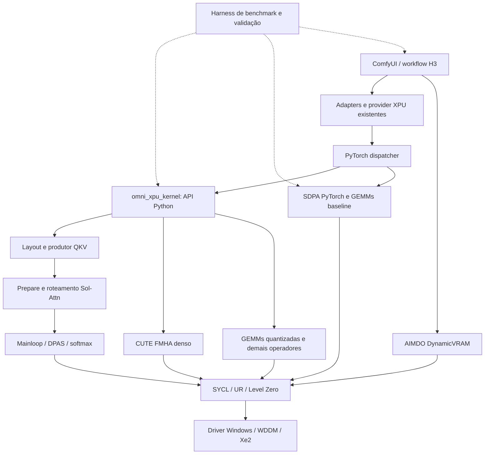
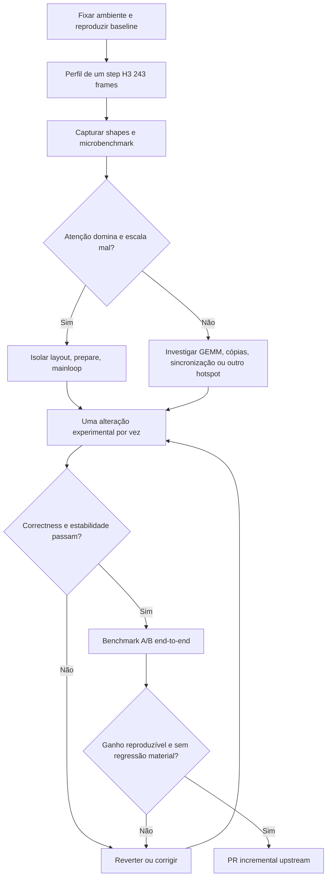

# Plano e arquitetura — otimização de kernels Xe2/Battlemage para Video DiT

**Status:** proposta experimental; nenhuma alteração de kernel implementada ou ganho adicional demonstrado.
**Alvo inicial:** Intel Arc Pro B70 32 GB, Windows 11, MiniMax H3/Ref2VA, ComfyUI. Projetado para contribuições incrementais ao upstream Intel.

## 1. Objetivo e limites

Reduzir o tempo de inferência de vídeo mantendo qualidade, estabilidade, compatibilidade com o ecossistema ComfyUI/PyTorch XPU e possibilidade de contribuição upstream. Priorizar ganhos algorítmicos e de utilização da GPU, não apenas contagem de camadas da stack.

Separar três eixos: (1) overhead host/dispatch, (2) eficiência computacional e de memória dos kernels, (3) estabilidade driver/WDDM. Tratar cada um com métricas próprias. Não assumir que eliminar camadas, usar DPAS, migrar para Vulkan ou aumentar a fusão resolve os três.

Não objetivos iniciais: novo motor DiT, fork permanente de ComfyUI/PyTorch, Level Zero direto, migração Vulkan, mudanças de pesos/modelo, desabilitação global de DynamicVRAM, alterações de TDR, promessas de paridade com CUDA. Não reduzir qualidade silenciosamente. Não reescrever o Sol-Attn até haver evidência de gargalo.

## 2. Estado de partida e evidências

- Integração Windows: [wildersa/ComfyUI-Intel-Arc-XPU](https://github.com/wildersa/ComfyUI-Intel-Arc-XPU), incluindo adapters, instalação, telemetria e wheels.
- [Proveniência do pacote](https://github.com/wildersa/ComfyUI-Intel-Arc-XPU/blob/main/THIRD_PARTY_NOTICES.md): Intel `1101fd71e10757e90bb6aae0eddbe1aea6317bb3`, Kitchen `f27f58782c51b6ab314b4cc0f6e65c8a6bafa277` (0.2.41), AIMDO `3bc6afbcb92e10a2d4737e79d170190ed787bf89` (0.6.0). Wheel publicada: `0.2.0b3+torch213.bmg`, Python 3.13, Torch 2.13.0+xpu.
- [PR AIMDO #37](https://github.com/xiangyuT/comfy-aimdo-xpu/pull/37), merged em 2026-11-25, corrige dupla contabilização UR/L0 no Windows. Com trim reativo adicional, pesos ~20.000 MiB permaneceram residentes, rel=0 após step inicial. Não atribuir todo o ganho exclusivamente à PR. O pin publicado de AIMDO antecede o merge; confirmar se a wheel instalada inclui o patch.
- [Benchmarks publicados](https://github.com/wildersa/ComfyUI-Intel-Arc-XPU/blob/main/benchmarks/README.md): H3 1344x768, 243 frames, 4-step Turbo: 490,49 s denso e 359,05 s Sol-Attn (tempos end-to-end reportados). A observação de 101,8 s/it pertence a uma execução relatada separadamente; não inferir tempos por step a partir dos totais publicados. Reproduzir e capturar configurações completas.
- [Comparação Intel](https://github.com/intel/llm-scaler/compare/1101fd71e10757e90bb6aae0eddbe1aea6317bb3...main), verificada em 2026-11-25: seis commits à frente, 20 arquivos alterados, sem mudanças diretas nos arquivos Sol-Attn; nova atenção FP32 D72 para vision encoder, não correção demonstrada do D128 H3.
- Main atual do fork também seis commits à frente da baseline na inspeção. Documentação de build b4 aponta wheel Windows ainda sem aceitação completa. Não assumir que b4 ou Torch 2.14 funcionam no ambiente atual.
- [Intel #730](https://github.com/intel/llm-scaler/issues/730), [#756](https://github.com/intel/llm-scaler/issues/756), [#729](https://github.com/intel/llm-scaler/issues/729): referências de investigação, não provas de equivalência de workloads ou causa única.
- [horvay/b70-minimax-h3](https://github.com/horvay/b70-minimax-h3): referência externa para gerenciamento de memória, atenção e chunking em Linux; não transpor resultados diretamente ao Windows. [IGCIT #1487](https://github.com/IGCIT/Intel-GPU-Community-Issue-Tracker-IGCIT/issues/1487): relato Vulkan/TDR; não evidencia que driver gaming corrige Level Zero.

## 3. Arquitetura proposta

Manter os contratos existentes. O fork Intel é o laboratório de código nativo; o projeto Windows permanece a bancada de integração e distribuição.

Diagrama lógico, não uma pilha universal para todos os operadores. O caminho Kitchen pode chamar operadores por interfaces distintas; confirmar o caminho ativo no runtime.

| Componente | Responsabilidade | Local |
|---|---|---|
| Kernel lab | Alterações de algoritmo, tiling, roteamento, DPAS, layout nativo | wildersa/llm-scaler, `omni/omni_xpu_kernel` |
| Harness | Microbenchmarks, correctness, manifesto de runs, regressões | mesmo fork; diretório experimental separado ou infraestrutura de testes existente |
| Integração | Adapters, provider bootstrap, profiling end-to-end e instalação da wheel | wildersa/ComfyUI-Intel-Arc-XPU |
| Kitchen | Dispatch/wrappers; alterar somente se perfil justificar | xiangyuT/comfy-kitchen-xpu |
| AIMDO | Residência, contabilização e pressão de memória | xiangyuT/comfy-aimdo-xpu, correção #37 já upstream |

**Princípio:** preservar API, dispatcher, stream/queue, ownership, lifetime de tensores, semântica de máscara, dtype, layout de saída e fallback. Novas variantes inicialmente opt-in, baseline intacta. Não introduzir sincronizações ocultas nem alocador concorrente. Workspace, quando justificado, deve respeitar device, stream, concorrência, limite de capacidade e DynamicVRAM; jamais reusar buffer ainda em voo.

### Mapa inicial de código

Sob `omni/omni_xpu_kernel/omni_xpu_kernel/cute/`:
- `sol_attn_v2.py`: validação, produtor chunked, _finish, layout, orquestração e controles de token augmentation.
- `sol_attn_prepare.cpp`: preparação/centroides/seleção, investigar custo real.
- `sol_attn_routes.hpp`: lógica de roteamento.
- `sol_attn_mainloop.hpp`: cálculo matricial, tiles, estados de softmax.
- `sol_attn_torch.cpp`: bindings e dispatch nativos.
- `cute_fmha_torch.cpp` e `__init__.py`: baseline denso CUTE, registro e seleção de capacidades.

Confirmar caminhos e símbolos no SHA de cada experimento. Não confundir produtor QKV chunked com chunking de queries da atenção. O caminho token_aug no _finish usa operadores de centroides, rotas, histogramas, seleção e forward dividido; contar dispatches reais (um operador pode lançar múltiplos kernels). A alternativa sem token_aug é uma ablação de algoritmo, não substituição numericamente equivalente.

## 4. Fluxo experimental e gates

Trilha de estabilidade em paralelo: hang/TDR, falha de dispositivo, OOM ou pressão de residência são investigados separadamente; nenhum experimento instável é promovido. Se houver reset de GPU/USB, suspender escalada, coletar eventos Windows e investigar plataforma, sem atribuir automaticamente à GPU ou ao USB. Linux xe ou driver alternativo são testes diagnósticos opcionais, não requisitos do objetivo Windows.

### Fase 0 — baseline reproduzível

- Desenvolvimento a partir da main recente do fork. Registrar SHA exato, manter referência histórica 1101fd71 para comparação. Não atualizar Torch, drivers, AIMDO e kernels simultaneamente.
- Compilar primeiro upstream sem alterações, para bmg/cp313/Torch 2.13 se suportado; se falhar, documentar incompatibilidade e estabelecer matriz separada de toolchain. Não renomear wheel para simular compatibilidade.
- Fixar driver, Windows build, oneAPI/ocloc, oneDNN headers e DLL, sycl-tla SHA, Python/Torch/XPU runtime, flags, SHA256 de wheel, commit Kitchen/AIMDO, configuração do allocator e reserve-vram.
- Usar documentação [WHL_BUILD_INSTALL.md](https://github.com/intel/llm-scaler/blob/main/omni/omni_xpu_kernel/WHL_BUILD_INSTALL.md). Windows CUTE/Sol-Attn exige `OMNI_XPU_DEVICE=bmg` e `OMNI_XPU_REQUIRE_CUTE=1`; confirmar AOT target, import fora do source checkout, presença da sidecar CUTE, capabilities e dispatch ativo.
- Venv de build isolado, wheel instalada em ambiente experimental ComfyUI, sem dependências automáticas; preservar wheel de rollback. Instalador de produção tem pin e checksum: não substituir arquivo sem ajustar manifesto em uma integração experimental separada; não alterar releases.
- Repetir referência H3 e registrar cold/warm separadamente. Gate: wheel carrega, testes de smoke/correctness passam, rota ativa comprovada, execução completa estável e baseline armazenada.

### Fase 1 — perfil end-to-end (primeiro)

- Warm-up separado; um step representativo após carregamento, em 243 frames, 1344x768 e configurações reais. Repetir sem profiler para medir overhead. Confirmar número de steps e se o step observado inclui CFG, offloading ou outros componentes.
- Capturar nomes de operadores/kernels, device/host timestamps, duração, launches, dependências, gaps, cópias, uso e residência VRAM, VBAR rel, memória compartilhada e CPU.
- Categorias exclusivas: atenção (layout, prepare, mainloop), GEMMs (INT8/ConvRot etc.), normas/modulação/rotary, cópias e outras operações, espera/ocioso. Reportar tempo de device e wall time; não somar intervalos sobrepostos como se fossem exclusivos. Registrar fração no caminho crítico e no wall time.
- Usar profiler PyTorch com atividade XPU quando disponível no build; validar cobertura. Complementar com tracing UR/L0/ETW ou ferramenta Intel suportada no Windows, e marcadores de fase. Não assumir disponibilidade de métricas XMX/GRF. Se indisponíveis, registrar limitação.
- Registrar shapes, strides, dtype, heads, head dim, q/k lengths, máscaras, scale, topk, tau, token_aug, sinks, coarse_gate, chunking, forma do produtor e frequência dos operadores. Sem registrar pesos, prompts ou conteúdo sensível de tensores em repositório público. Tensores sintéticos reproduzíveis quando suficientes; captura real local e opcional.
- Gate: hotspot quantificado e explicado; priorizar pela fração de tempo e potencial de melhoria (lei de Amdahl), não apenas maior porcentagem de ganho isolado.

### Fase 2 — microbenchmarks

| Variante | GPU | Controle |
|---|---|---|
| SDPA denso PyTorch (backend efetivo registrado) | B70 | baseline framework |
| CUTE FMHA denso | B70 | baseline da família de kernels |
| Sol-Attn atual com parâmetros reais | B70 | baseline esparsa |
| Sol-Attn sem token_aug | B70 | ablação de custo e qualidade |
| Sol-Attn CUDA + baseline densa CUDA | RTX 4070 | ganho relativo dentro de cada dispositivo |

- Matriz inicial 8k, 16k, 32k, 64k tokens; incluir shape real do H3 e tamanhos não múltiplos de tiles, head dim e batch reais. B=1, H=56, D=128 apenas hipótese inicial até capturar os shapes. Testar FP16/BF16 conforme uso real. Escalar progressivamente, respeitando orçamento de VRAM e tempo seguro; N/A se não couber ou backend não suportar. Não forçar matriz de atenção densa materializada.
- Seeds e inputs comuns, mesma máscara, precisão e parâmetros, layouts equivalentes. Mesma semântica no comparativo de variantes equivalentes. Medir núcleo isolado com tensores residentes e pipeline real incluindo layout/produtor.
- Warm-up até estabilizar (registrar iterações), proposta inicial ≥10 medições estáveis quando viável, menos apenas com justificativa para casos longos. Randomizar/intercalar A/B, monitorar clocks, temperatura e potência quando disponíveis. Reportar mediana, p95, dispersão e número de amostras; p95 com amostra pequena é exploratório.
- Sincronizar nas fronteiras da medição de latência total; medir fases com eventos/timeline no device, não inserir sync entre todos os operadores como resultado principal. Medição intrusiva separada se necessária.
- Medir layout/contiguous, produtor QKV, prepare/roteamento e mainloop, estado intermediário, launches, picos allocated/reserved e residência real. Para XMX: throughput efetivo, métricas de ocupação/spill somente quando verificáveis. FLOPS de denso e esparso não são diretamente equivalentes.
- Comparar speedup = tempo denso / tempo esparso por GPU (ou inverso explicitamente rotulado); não comparar tempo bruto entre arquiteturas como diagnóstico isolado.
- Testar correctness contra Sol-Attn upstream para mudanças equivalentes; comparar ambos com denso para medir aproximação já existente. Sem token_aug, tau/topk diferentes e mudança de precisão são experimentos de qualidade separados.
- Gate: localizar custo dominante ou concluir que atenção não é o alvo prioritário.

### Fase 3 — otimizações condicionadas aos dados

| Evidência | Experimento | Riscos/validação |
|---|---|---|
| Cópias/layout dominam | Consumir layout original ou fundir produtor QKV com transformação já necessária; evitar contiguous redundante | strides, alinhamento, layout de saída, concorrência |
| Centroides/prepare dominam | Agrupar produtos escalares em tiles DPAS; fundir score e seleção onde possível | manter critérios, empates, máscaras, topk e precisão; testar caminhos alternativos já existentes |
| Histogramas/roteamento dominam | compactação de índices, redução de varreduras, fusão seletiva | ordem, duplicatas, tokens inválidos, bordas, divergência |
| Estado parcial/grande buffer domina | testar forward unificado já existente se compatível com token_aug, ou reduzir materialização por chunk | equivalência de softmax online e custo de ocupação; não presumir que variante dividida seja pior |
| Mainloop domina | tiling, GRF, ocupação, reutilização de Q/K/V, prefetch, acesso coalescido; verificar DPAS já presente | spills, limites de registradores, desempenho em shapes diferentes |
| Dispatch/host gaps dominam | reduzir operações pequenas, reutilizar workspace e avaliar XPUGraph se suportado | lifetime, captura, formas variáveis, dependência e compatibilidade AIMDO |
| Dispatch muito longo / falhas | dividir queries preservando visão completa de K/V, roteamento global e estado; investigar causa do erro | TDR não comprovado só pelo hang; chunking pode alterar resultados se aplicado incorretamente |
| GEMM fora da atenção domina | perfil separado INT8/ConvRot/W4A8/NVFP4 conforme rota real | quantização, escalas, fallback, acurácia |

A Intel já usa DPAS e possui variantes fusionadas. Não propor 'adicionar XMX' genericamente. Em token_aug, `forward_cute_selected` e `forward_cute_prepared_split` são candidatos a análise: verificar buffer intermediário, custo de write/read, opção unificada e motivos do desenho original. Não assumir que uma fusão aumentará desempenho ou estabilidade; pode elevar pressão de registradores e duração de dispatch.

A cada alteração: teste mínimo, microbenchmark, revisão de precisão e memória, depois E2E; uma variável por vez. Se ganho negativo ou qualidade degradada, manter baseline e registrar resultado. Nenhuma otimização específica tem aprovação antecipada.

### Fase 4 — aceitação e upstream

- Testes unitários, integração Python/C++ e casos de borda (comprimentos irregulares, máscaras, padding, strides, batch, topk/threshold, token augmentation, chunks, tipos suportados, valores extremos, NaN/Inf, repeatability). Reutilizar testes do upstream e tolerâncias justificadas; não impor bitwise equality a algoritmos de ponto flutuante com ordem diferente.
- Métricas numéricas: erro absoluto/relativo, RMSE, cosseno e distribuição de erros; checar seleção de blocos onde a semântica exige equivalência; validar erro vs denso e vs sparse upstream. Fixar thresholds antes do teste com base nas tolerâncias existentes e erro da baseline.
- Qualidade vídeo: conjunto fixo de prompts, referências e seeds locais, comparação pareada de frames, consistência temporal/identidade/movimento e inspeção visual. Para alterações aproximadas, revisão humana explícita; não inferir qualidade apenas do erro de atenção.
- Estabilidade: proposta inicial de 10 execuções H3 completas em 243 frames e workloads menores de regressão, sem hangs, device loss, OOM novos ou regressão de residência; publicar contagem e duração, sem inferir estabilidade universal.
- Meta experimental proposta: ≥10% ganho de mediana no hotspot e ≥5% E2E, ou ganho material de memória/estabilidade com justificativa e sem regressão relevante. Ganhos menores comprovados também podem justificar PR de baixo risco. Definir orçamento de regressão por shape (proposta 3% se acima do ruído) antes de promover.
- Verificar outros caminhos compartilhados (CUTE denso, WAN, Qwen/FLUX conforme disponibilidade, D72 e demais shapes existentes), build Windows e Linux quando possível; se Linux não testado localmente, registrar e solicitar CI/review upstream.
- PR pequena, independente e com resumo da causa, diff focado, teste de regressão, ambiente completo, benchmark A/B, números brutos sanitizados, limitações e rollback. Não incluir mudanças experimentais de integração, binários ou dados privados em PR Intel. Usar upstream como base da contribuição, respeitar licenças e guias locais. Xiangyu revisa PRs Omni (ex. [#495](https://github.com/intel/llm-scaler/pull/495), [#552](https://github.com/intel/llm-scaler/pull/552)); solicitar feedback técnico quando houver evidências, sem pressupor aprovação.

## 5. Organização e artefatos

Proposta de branches: `main` do fork para documentação e sincronização; branch de benchmark e branches temáticas curtas (por exemplo `experiment/bmg-sol-attn-prepare`), derivadas do SHA upstream registrado. Baseline histórica por SHA; não misturar commits do plano em PRs upstream de kernel.

Proposta de diretório experimental, ajustar ao padrão de testes existente após inspeção:

- `omni/omni_xpu_kernel/benchmarks/bmg_video_dit/`: harness, manifesto de cenários, README, schema de resultados.
- `omni/omni_xpu_kernel/tests/`: regressões e equivalência numérica junto dos testes existentes.
- Artefatos locais (fora do Git): logs pesados, traces, dumps/tensores, vídeos e wheels experimentais.
- Resultados versionados sanitizados: manifesto com SHA fonte, wheel hash, ambiente, shape, backend, parâmetros, amostras, timings, VRAM, status, falhas e conclusão. Não versionar checkpoints ou binários grandes sem decisão explícita.

Manter as ferramentas de profiling e integração no projeto Windows quando dependentes de ComfyUI, com links cruzados. O harness nativo deve rodar sem ComfyUI.

## 6. Próximas demandas em ordem

| ID | Prioridade | Entrega | Dependência |
|---|---|---|---|
| BMG-01 | Alta | manifesto de baseline, build b4 limpo e aceitação Windows, rollback | nenhuma |
| BMG-02 | Alta | perfil real de um step H3 + diagnóstico de residência/estabilidade | BMG-01 (perfil histórico pode ser feito em paralelo) |
| BMG-03 | Alta | harness denso/esparso XPU/CUDA, captura de shapes, métricas de correctness | BMG-02 |
| BMG-04 | Alta | breakdown layout/prepare/mainloop e decisão quantitativa | BMG-03 |
| BMG-05 | Média | primeiro patch de otimização condicionado ao hotspot | BMG-04 |
| BMG-06 | Média | regressão, estabilidade, qualidade, A/B end-to-end | BMG-05 |
| BMG-07 | Média | PR upstream e wheel candidata de integração | BMG-06 |

Trilha de estabilidade transversal: bloquear promoção se houver regressão de driver, sincronização ou memória. Se build mais recente for incompatível, não bloquear o profiling da wheel existente: manter a baseline histórica e resolver build separadamente.

**Primeira ação:** executar BMG-01 e instrumentar BMG-02. Não iniciar reengenharia do kernel sem perfil. O principal resultado desta etapa é uma decisão sustentada por dados sobre qual operador modificar.

## 7. Limitações atuais

Não houve execução de benchmark nesta elaboração. Não foi validada a wheel b4 em Windows nem a versão efetivamente instalada localmente, incluindo patch AIMDO e ajustes locais. Não se conhece ainda a fração dos 101,8 s/it atribuível a cada operador, o ramo de Sol-Attn ativo, nem o limite de sequência da RTX 4070 para cada variante. O ganho potencial e a causa de hangs são hipóteses a testar. As metas e organização de branches acima são propostas de engenharia, não requisitos upstream confirmados.
